**中文** | [English](README_EN.md)

# Fable 5.5 Testing Series — Claude Fable 5.5 实测案例索引

收集 X (Twitter) 上关于 **Claude Fable 5.5** 的单句提示词动画、3D 与交互测试案例：链接、提示词、耗时与成本、结果亮点，一处索引。

> **注意**：截至 2026 年 11 月，Fable 5.5 尚未被 Anthropic 官方发布。以下均为早期访问/路由报告，请以原帖为准。
> 本仓库仅做整理与索引；每条案例的预览为原视频前 5 秒的 WebP 动图，完整内容请看原帖。原帖与视频版权归各原作者所有。

> 💡 **如何贡献**：在本仓库提交 [Issue](../../issues/new?template=submit_case.yml)（模板会自动带 `submission` 标签），只需粘贴一条推文链接，GitHub Actions 会自动解析、分类并更新本页与 `data/cases.json`。

## 总览表

| 预览 | Part | 标题 | 作者 | 耗时 | 成本 | 时长 | 日期 | 原帖 |
| :--- | :--- | :--- | :--- | :--- | :--- | :--- | :--- | :--- |
|  | — | 《最后的一页》吉卜力风短片 | @chetaslua | — | — | — | 2026-11-02 | [链接](https://x.com/chetaslua/status/2117224843661980093) |
| 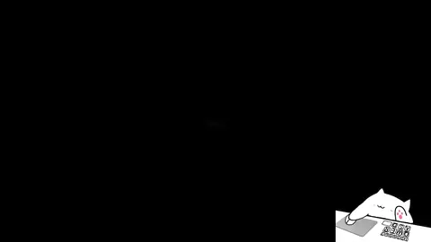 | — | 一小时纯代码动画 | @notjazii | — | — | 262.566s | 2026-11-02 | [链接](https://x.com/notjazii/status/2117221957104239010) |
| 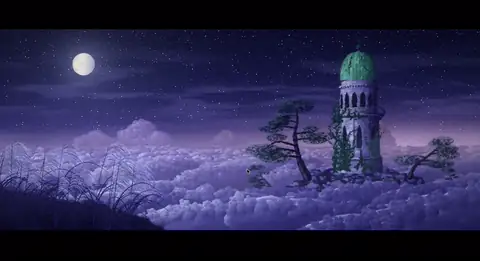 | — | 零图像模型动画短片 | @chetaslua | — | — | 58.453s | 2026-11-02 | [链接](https://x.com/chetaslua/status/2117224839010459987) |
|  | — | Fable 5.5 战斗动画 | @notjazii | — | — | 30.046s | 2026-11-02 | [链接](https://x.com/notjazii/status/2117261864904351848) |
| 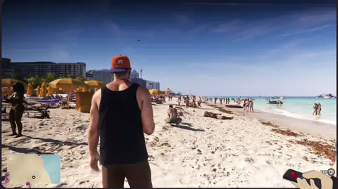 | — | SVG版GTA6沙滩动画 | @imjustnewatai | — | — | 21.385s | 2026-11-03 | [链接](https://x.com/imjustnewatai/status/2117678536794296462) |
|  | — | 生命之树生成动画 | @notjazii | — | — | 30s | 2026-11-04 | [链接](https://x.com/notjazii/status/2117972258090357164) |
| 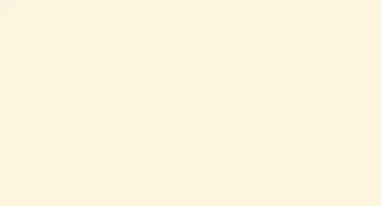 | — | Fable 5.5 一次生成42秒动画 | @0xMovez | — | — | 42s | 2026-11-03 | [链接](https://x.com/0xmovez/status/2117700681867903169) |
| 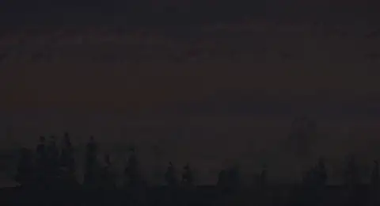 | — | 纯代码视频惊艳模型 | @chetaslua | — | — | 80.666s | 2026-11-02 | [链接](https://x.com/chetaslua/status/2117169796290916732) |
| 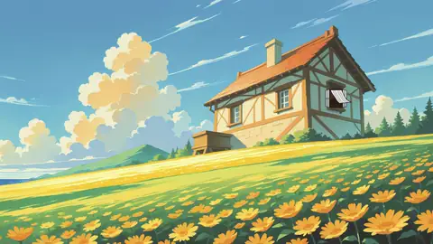 | 初始 | Clockwork Bird（发条鸟） | @camperaigg | 1h54m | ~$20 | 60s | 2026-11-03 | [链接](https://x.com/camperaigg/status/2117666378174050352) |
| 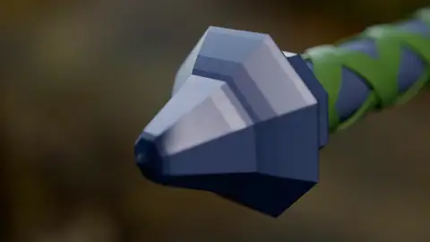 | Part 2 | Link's Master Sword | @camperaigg | 32min+ | $11.66 | 34s | 2026-11-03 | [链接](https://x.com/camperaigg/status/2117694354685092255) |
| 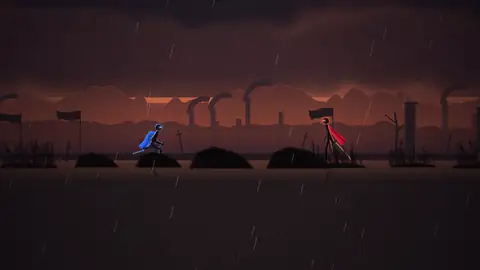 | Part 3 | Anime Stickman Sword Fight | @camperaigg | 66min | $15.71 | 46s | 2026-11-03 | [链接](https://x.com/camperaigg/status/2117717189059026969) |
| 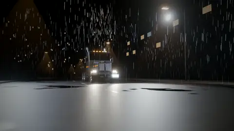 | Part 4 | Transformer Truck | @camperaigg | 107min | $9.64 | 12.5s | 2026-11-04 | [链接](https://x.com/camperaigg/status/2117914482752299311) |
| 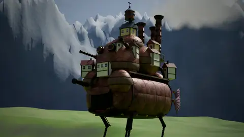 | Part 5 | Howl's Moving Castle | @camperaigg | 133min | $12.37 | 35s | 2026-11-04 | [链接](https://x.com/camperaigg/status/2117966825048997914) |
| 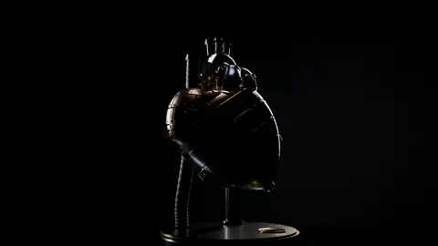 | Part 6 | Mechanical Heart | @camperaigg | 106min | $12.35 | 30s | 2026-11-04 | [链接](https://x.com/camperaigg/status/2118002649929056373) |
| 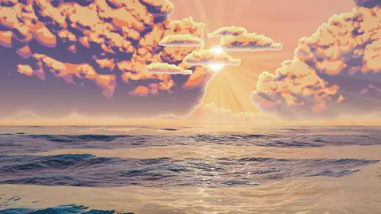 | Part 7 | Whale Breach | @camperaigg | 154min | $17.85 | 31s | 2026-11-04 | [链接](https://x.com/camperaigg/status/2118069524306284556) |
## 🎬 动画与视频生成 (Video & Animation)

| 预览 | 案例名称与摘要 | 技术栈 & 状态 | 原始 Prompt / 链接 |
| :--- | :--- | :--- | :--- |
| 暂无预览 | **《最后的一页》吉卜力风短片** 生成60秒手绘2D动画，红狐唤醒图书馆，呈现影院级吉卜力美学与原创配乐。 *By @chetaslua (2026-11-02)* | `HTML5` `Web Audio` 🏷️ 实测验证 | [🔗 原推文](https://x.com/chetaslua/status/2117224843661980093) 

查看 Prompt
<pre>Create a launch film for Fable 5.5 as a 2D anime short for the web. It must look completely like real Japanese anime, as if it were taken directly from a finished theatrical anime film. This is traditional-looking, hand-drawn 2D anime, not a 3D animation, a moving illustration, a stylized web graphic, or a tech-company product ad.  Deliver the final result as a single, self-contained HTML file with sound. Use any tools, libraries, references, guides, literally anything. Pre-rendering the film and embedding it in the file is allowed. All artwork and audio must be original. The page should be a black, letterboxed cinema frame with one quiet play button (browsers block autoplay with sound) and nothing else on screen.  Use Studio Ghibli films as the art style reference for the design, line work, painted backgrounds, color, and atmosphere, without copying any existing character or shot. No people appear in the film. The main character is an original small red fox, because fables have always been told through animals. Use any tools or techniques you want, including 3D for layout, as long as the final result looks 100% like hand-drawn 2D anime.  THE FILM: "THE LAST PAGE" (about 60 seconds, 24 fps)  The idea: Fable means story. A forgotten library holds every story ever written, and it has been asleep for a very long time. One small fox wakes it up.  Shot 1, Before Dawn (0:00–0:07). Black. The sound of wind comes first. Fade up on a vast blue-violet sea of clouds at the last hour of night. An ancient stone library tower stands on a cliff above the clouds, with a cracked copper dome gone green, wrapped in ivy and old pines. One small warm light moves across a window. Pampas grass sways in the foreground. Almost nothing else moves. Hold.  Shot 2, The Reading Hall (0:07–0:14). Inside, shelves climb into darkness, holding thousands of unique books: leaning, sagging, sun-faded, some with moss growing along the spines. Moonlight falls in one dusty shaft. Tiny against all of this, the fox pads in from the left, carrying a small paper lantern in its mouth. It stops, sets the lantern down, and looks up.  Shot 3, The Fox (0:14–0:18). Close-up. Ears swivel one at a time. It sniffs, then blinks, a real anime blink with a hold on the closed frame. Lantern light shows in its eyes. It is curious and a little afraid, and the audience should fall in love with it here.  Shot 4, The Blank Book (0:18–0:25). An enormous open book rests on a lectern, its pages empty and yellowed. The fox hops up and places one paw on the page. Silence. A single line of ink appears under the paw and begins to draw itself in one confident brushstroke. It becomes a tiny sketched bird. The bird shivers, then peels off the page and flaps into the air, still made of ink and paper.  Shot 5, The Library Stirs (0:25–0:32). A book on a high shelf trembles. Then a whole row. Dust sifts down in thin streams. A deep, low creak travels up through the tower. The lantern flame leans sideways with no wind to move it. The fox flattens its ears. Cut between shelves on hard, held key poses as the tension builds. Hold one beat of total stillness.  Shot 6, The Pages Burst (0:32–0:39). Every book flies open at once. Thousands of pages tear free, folding into paper birds mid-air on sharp drawn frames. Cut to a dramatic low angle looking straight up the circular stairwell as the flock spirals in a huge rising vortex toward the dome. The dome's old copper shutters break open and the first gold light crashes down the shaft.  Shot 7, Sunrise (0:39–0:44). Outside, the sun clears the sea of clouds. The fox has climbed out onto a stone balcony, fur and grass whipping in the wind, tiny against the sky. It looks up with its mouth slightly open. A great ring of wind rolls outward across the clouds.  Shot 8, The Great Bird (0:44–0:52). This is the climax. High in the golden sky, the flock pulls together into one colossal bird made of a hundred thousand pages, with handwriting and old illustrations visible across its wings. It gives one enormous wingbeat with real weight, then tears across the sky in a sweeping arc, leaving a curving trail of light, mist, and loose paper. Make this the widest, most awe-inspiring image in the film.  Shot 9, The Last Page (0:52–1:00). Quiet returns. Pages spiral down through sunbeams onto the balcony. One lands at the fox's paws. It is the only page still blank. The fox looks at it, then at us, and places its paw down. Ink blooms from under the paw and writes, in one hand-brushed stroke:  Fable 5.5  Below it, a small red hanko seal reading 寓話 presses into the paper, followed by one line in smaller brushed lettering: "Every story begins with a blank page."  Hold on the title. The fox's tail flicks once. Fade to paper, then black. Do not add logos, feature lists, benchmarks, or any product claims.  ANIME QUALITY STANDARD Every frame must look as if it was drawn by professional anime animators and painted by master background artists for a finished theatrical film.  Fox: A hand-drawn anime character with a simple, appealing, solid design, cel-colored forms, and clear silhouettes. Keep it on-model from every angle, and let its ears, tail, posture, and eyes express emotion without any words. Paper birds and the great bird: Hand-drawn with real paper character, including creases, curled corners, and faded ink. The great bird must keep a consistent design and feel immense. Line art: Confident, delicate, hand-inked anime line work with subtle variation in thickness and pressure. Coloring: Traditional anime cel coloring with clean color areas, simple hard-edged shadows, and a soft, natural palette. Backgrounds: Richly detailed, hand-painted anime backgrounds in a gouache style, with visible brushwork, natural color variation, layered depth, and individually considered books, stones, foliage, and clouds. Lighting: The film travels from cool moonlit blue and warm lantern amber to overwhelming golden sunrise. Use colorful shadows, glowing mist, drifting dust, and soft atmosphere that unite characters and background. Animation: Authentic hand-drawn anime timing, mostly on twos and threes, with real weight, strong key poses, natural holds, smears on the fastest frames, and overlapping movement in fur, grass, ivy, paper, and dust. The film should build slowly, then release with explosive power. Direction: Cinematic anime shots, beautiful composition, thoughtful staging, and pacing that starts quietly, builds tension, and ends in a soaring climax, followed by one small, tender moment. Text: All text must look brushed in ink on paper and appear only in the final shot, with no web fonts sitting on top of the picture.  SOUND Create an original score and sound design, with no borrowed melodies. Start with wind and near-silence, then add a lone felt piano motif when the fox appears. Bring in low strings and creaking wood during the tremor, then a sudden roar of fluttering paper, and a full orchestral swell at sunrise. At the climax, the piano motif returns at full scale. End with a single soft piano note as the ink touches the final page. Sound effects should include paw steps, lantern flame, ink, dust, page rustle, and the huge wingbeat.  IT MUST NOT LOOK LIKE - 3D: No plastic materials, CGI shading, visible polygons, game-engine lighting, or computer-perfect perspective. - SVG or vector art: No simple geometric shapes, perfect curves, uniform outlines, flat corporate illustration, or basic gradients. - Web animation: No sliding layers, constant bobbing, floating parts, smooth software easing, or puppet-like joint rotation. - AI art: No warped shapes, melted details, flickering, garbled text, or changing character designs. - Non-anime art: No Western cartoon designs, realistic rendering, soft painterly shading on the characters, or generic digital illustration. - Tech advertising: No glowing neural networks, circuit patterns, chat bubbles, UI mockups, futuristic HUDs, particle-logo reveals, or typed-out text effects. - Amateur work: No stiff poses, empty backgrounds, repeated books or trees, identical paper birds, muddy colors, clip art, placeholders, or unfinished details.  You are free to change any part of this prompt if it would produce a better result.  The result should feel awe-inspiring, nostalgic, and full of wonder, like the moment a story you loved as a child comes back to you. Before finishing, inspect random frames as still images from every shot. If any frame does not look completely like real 2D anime, keep improving it. Do not stop until every frame could pass as a still from a theatrical anime film.</pre>
 |
|  | **一小时纯代码动画** 仅用纯代码无外部素材生成高质量动画，一小时完成，效果惊艳。 *By @notjazii (2026-11-02)* | 🏷️ 灰度路由/传闻 | [🔗 原推文](https://x.com/notjazii/status/2117221957104239010) 

查看 Prompt
<pre>make an animation that makes me feel like it’s agi</pre>
 |
|  | **零图像模型动画短片** 用Python自写代码生成66秒动画，含音效与视觉，无外部素材。 *By @chetaslua (2026-11-02)* | `Python` `HTML5` 🏷️ 实测验证 | [🔗 原推文](https://x.com/chetaslua/status/2117224839010459987) 

查看 Prompt
<pre>未公开</pre>
 |
|  | **Fable 5.5 战斗动画** 展示 Claude Fable 5.5 生成战斗动画的灵活能力，强调模型泛化潜力。 *By @notjazii (2026-11-02)* | 🏷️ 灰度路由/传闻 | [🔗 原推文](https://x.com/notjazii/status/2117261864904351848) 

查看 Prompt
<pre>未公开</pre>
 |
|  | **SVG版GTA6沙滩动画** Fable 5.5用单文件SVG生成GTA风格沙滩动画，包含海浪、打斗与物理效果。 *By @imjustnewatai (2026-11-03)* | `SVG` `HTML5` 🏷️ 实测验证 | [🔗 原推文](https://x.com/imjustnewatai/status/2117678536794296462) 

查看 Prompt
<pre>I asked Fable 5.5, to create an SVG animation of GTA 6 on a crowded, sunny beach. A German shepherd takes a shit in the sand, then the player gets into a fistfight with a nearby NPC. Include photorealistic graphics, realistic physics, ocean waves, animated beachgoers, a third-person camera, and a GTA-style minimap. Render everything in one self-contained SVG file.</pre>
 |
|  | **生命之树生成动画** Fable 5.5 单次生成纯代码动画，展示复杂视觉创作能力。 *By @notjazii (2026-11-04)* | 🏷️ 灰度路由/传闻 | [🔗 原推文](https://x.com/notjazii/status/2117972258090357164) 

查看 Prompt
<pre>未公开</pre>
 |
|  | **Fable 5.5 一次生成42秒动画** 使用纯Three.js与代码渲染生成高质量动画，无需视频模型且离线运行。 *By @0xMovez (2026-11-03)* | `Three.js` `HTML5` 🏷️ 实测验证 | [🔗 原推文](https://x.com/0xmovez/status/2117700681867903169) 

查看 Prompt
<pre>未公开</pre>
 |
|  | **纯代码视频惊艳模型** 用单一提示词生成高质量视频，效果优于AI视频模型。 *By @chetaslua (2026-11-02)* | 🏷️ 灰度路由/传闻 | [🔗 原推文](https://x.com/chetaslua/status/2117169796290916732) 

查看 Prompt
<pre>未公开</pre>
 |
|  | **Clockwork Bird（发条鸟）** 全矢量发条鸟自动组装成片，原创华尔兹与纯数学合成音效贯穿。 *By @camperaigg (2026-11-03)* | `Claude Code` `HyperFrames` 🏷️ 实测验证 | [🔗 原推文](https://x.com/camperaigg/status/2117666378174050352) 

查看 Prompt
<pre>一句提示词（未公开完整原文）</pre>
 |
|  | **Link's Master Sword** 单脚本在 Blender 中建模大师之剑并自动成片，附原创管弦乐。 *By @camperaigg (2026-11-03)* | `Claude Code` `Blender` 🏷️ 实测验证 | [🔗 原推文](https://x.com/camperaigg/status/2117694354685092255) 

查看 Prompt
<pre>Build Link's Master Sword in Blender（后续追加“make a video of it”）</pre>
 |
|  | **Anime Stickman Sword Fight** 动漫风火柴人剑斗：布料模拟、冲击闪与 228 个物理同步音效。 *By @camperaigg (2026-11-03)* | `Claude Code` 🏷️ 实测验证 | [🔗 原推文](https://x.com/camperaigg/status/2117717189059026969) 

查看 Prompt
<pre>Make me a video of 2 stickman fighting, anime style.</pre>
 |
|  | **Transformer Truck** 51 关节绑定变形卡车，雨幕涟漪与纯合成机械音效。 *By @camperaigg (2026-11-04)* | `Claude Code` `Blender` 🏷️ 实测验证 | [🔗 原推文](https://x.com/camperaigg/status/2117914482752299311) 

查看 Prompt
<pre>Make me a transformer truck with animations of its transforming.</pre>
 |
|  | **Howl's Moving Castle** 会行走的城堡：蒸汽机到四足步态全建模，中途开壳剖视。 *By @camperaigg (2026-11-04)* | `Claude Code` `Blender` 🏷️ 实测验证 | [🔗 原推文](https://x.com/camperaigg/status/2117966825048997914) 

查看 Prompt
<pre>Make me Howl's moving castle and also show its internal machinery.</pre>
 |
|  | **Mechanical Heart** 机械心脏开壳动画：双活塞曲轴与心跳同步配乐。 *By @camperaigg (2026-11-04)* | `Claude Code` `Blender` 🏷️ 实测验证 | [🔗 原推文](https://x.com/camperaigg/status/2118002649929056373) 

查看 Prompt
<pre>Make a mechanical heart and show its insides, use blender.</pre>
 |
|  | **Whale Breach** 1690 万粒子流体与 cel-shading 海洋，鲸鱼跃水成片。 *By @camperaigg (2026-11-04)* | `Claude Code` 🏷️ 实测验证 | [🔗 原推文](https://x.com/camperaigg/status/2118069524306284556) 

查看 Prompt
<pre>Make a whale breach a cel-shaded ocean.</pre>
 |
## 详细记录
### 初始：Clockwork Bird（发条鸟）
- **原帖**：[https://x.com/camperaigg/status/2117666378174050352](https://x.com/camperaigg/status/2117666378174050352) · **耗时**：1h54m · **成本**：~$20 · **时长**：60s- **提示词**：一句提示词（未公开完整原文）
- **亮点**：全矢量发条鸟零件飞入组装、连续镜头；原创华尔兹贯穿全片；纯数学合成音效（点击与帧精确同步 ±5ms）
### Part 2：Link's Master Sword
- **原帖**：[https://x.com/camperaigg/status/2117694354685092255](https://x.com/camperaigg/status/2117694354685092255) · **耗时**：32min+ · **成本**：$11.66 · **时长**：34s- **提示词**：Build Link's Master Sword in Blender（后续追加“make a video of it”）
- **亮点**：单脚本完整建模（Triforce 浮雕、编织握把、多层羽毛护手）；自动修复 z-fighting；连续运镜 + 森林光影 + 原创管弦乐
### Part 3：Anime Stickman Sword Fight
- **原帖**：[https://x.com/camperaigg/status/2117717189059026969](https://x.com/camperaigg/status/2117717189059026969) · **耗时**：66min · **成本**：$15.71 · **时长**：46s- **提示词**：Make me a video of 2 stickman fighting, anime style.
- **亮点**：骨骼 + 120Hz 布料、闪电刀 vs 火焰大剑；一帧冲击闪（mono/inverted/duotone）；16 乐器 120BPM 原创配乐；228 个物理同步音效（其中 79 个自动从剑尖速度检测）；高潮前全静音
### Part 4：Transformer Truck
- **原帖**：[https://x.com/camperaigg/status/2117914482752299311](https://x.com/camperaigg/status/2117914482752299311) · **耗时**：107min · **成本**：$9.64 · **时长**：12.5s- **提示词**：Make me a transformer truck with animations of its transforming.
- **亮点**：51 关节完整绑定 + 地面求解；Geometry Nodes 雨滴与涟漪；64 个纯合成音效（柴油/气刹/舵机等）
### Part 5：Howl's Moving Castle
- **原帖**：[https://x.com/camperaigg/status/2117966825048997914](https://x.com/camperaigg/status/2117966825048997914) · **耗时**：133min · **成本**：$12.37 · **时长**：35s- **提示词**：Make me Howl's moving castle and also show its internal machinery.
- **亮点**：完整蒸汽机→齿轮系→四足行走（从着地脚反解）；中途开壳剖视；步频精确华尔兹（1.4s/拍）；自动发现并优化草渲染（9.3s→4.2s/帧）
### Part 6：Mechanical Heart
- **原帖**：[https://x.com/camperaigg/status/2118002649929056373](https://x.com/camperaigg/status/2118002649929056373) · **耗时**：106min · **成本**：$12.35 · **时长**：30s- **提示词**：Make a mechanical heart and show its insides, use blender.
- **亮点**：双活塞曲轴、开壳动画；黄金油液气泡与滴落；心跳同步配乐；自动排查隐藏灯光问题
### Part 7：Whale Breach
- **原帖**：[https://x.com/camperaigg/status/2118069524306284556](https://x.com/camperaigg/status/2118069524306284556) · **耗时**：154min · **成本**：$17.85 · **时长**：31s- **提示词**：Make a whale breach a cel-shaded ocean.
- **亮点**：1690 万粒子流体（1200 steps/s）；三层 FFT 波浪 + cel-shading；109 万三角纯代码鲸鱼；水下光学（Snell's window）；自动发现并重渲染交叉线问题
## 相关资源
- 其他 Fable 5.5 社区合集：[awesome-fable5-5-videos](https://github.com/billyhetech/awesome-fable5-5-videos)、[awesome-fable-5.5-usecase](https://github.com/coolbat/awesome-fable-5.5-usecase)

## 说明与版权
- 所有视频与描述均来自各原作者的公开推文，请以原帖为准。
- 本仓库的整理与索引部分以 [MIT License](LICENSE) 发布；索引所指向的原帖内容与视频版权归原作者所有。
- 种子案例为 @camperaigg 的 Fable 5.5 Testing Series（Part 1–7）。
