[中文](README.md) | **English**

# Fable 5.5 Testing Series — Claude Fable 5.5 Hands-on Case Index

An index of single-prompt animation, 3D and interactive tests of **Claude Fable 5.5** posted on X (Twitter): links, prompts, build time & cost, and result highlights — all in one place.

> **Note**: As of November 2026, Fable 5.5 has not been officially released by Anthropic. Everything below is early-access / routing reports; please refer to the original posts.
> This repository is an index only. Each preview is a WebP animation of the first 5 seconds of the original video; see the original post for the full piece. All posts and videos belong to their respective authors.

> 💡 **Contribute**: Open an [Issue](../../issues/new?template=submit_case.yml) (the form auto-applies the `submission` label) and paste a tweet link — GitHub Actions will parse, classify and add it to this page and to `data/cases.json` automatically.

## Overview

| Preview | Part | Title | Author | Time | Cost | Length | Date | Post |
| :--- | :--- | :--- | :--- | :--- | :--- | :--- | :--- | :--- |
| 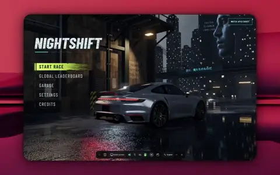 | — | Claude 一次生成漂移小游戏 | @Armaan_Jain123 | — | — | 39.146s | 2026-10-05 | [Link](https://x.com/Armaan_Jain123/status/2107251677615300969) |
| 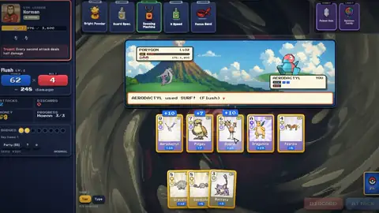 | — | Fable 5.5 一小时打造游戏 | @anshuc | — | — | 46.588s | 2026-10-05 | [Link](https://x.com/anshuc/status/2107180724399075488) |
|  | — | Discovering I've been routed to Fable 5. | @atomtanstudio | — | — | 126.783s | 2026-10-05 | [Link](https://x.com/atomtanstudio/status/2106900686764134654) |
| 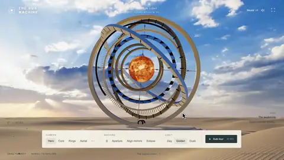 | — | 沙漠人造太阳交互场景 | @pankajkumar_dev | — | — | 74.6s | 2026-10-04 | [Link](https://x.com/pankajkumar_dev/status/2106762987872850092) |
|  | — | 一次生成像素Bug游戏 | @blueemi99 | — | — | 83.648s | 2026-10-05 | [Link](https://x.com/blueemi99/status/2107108802440900621) |
| 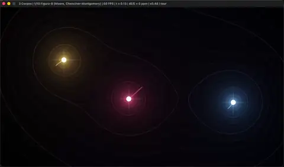 | — | 三体问题60帧渲染 | @zAdrielsan | — | — | 133.666s | 2026-10-02 | [Link](https://x.com/zAdrielsan/status/2105822678519001360) |
| 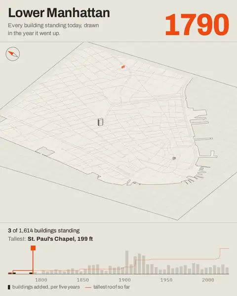 | — | I asked Fable 5.5 for something cool and | @nroze22 | — | — | 22.033s | 2026-10-03 | [Link](https://x.com/nroze22/status/2106183281293381661) |
|  | — | 3分钟未来人类进步动画 | @imjustnewatai | — | — | 189.013s | 2026-10-02 | [Link](https://x.com/imjustnewatai/status/2106081142143168580) |
| 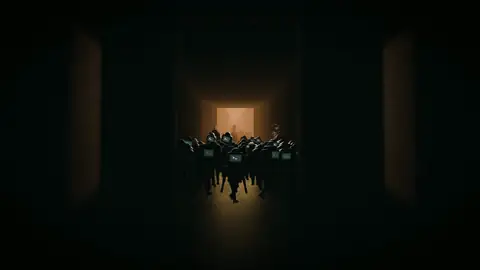 | — | Fable5.5想象HF事故 | @chetaslua | — | — | 220.933s | 2026-10-02 | [Link](https://x.com/chetaslua/status/2105884276864782557) |
| 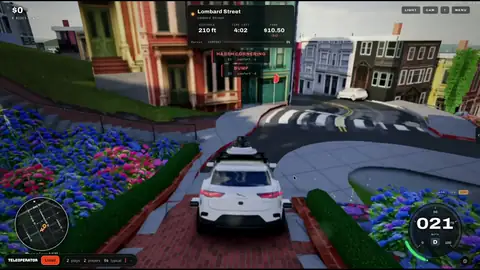 | — | Waymo驶过旧金山地标街 | @mindblown_ai | — | — | 72.655s | 2026-10-02 | [Link](https://x.com/mindblown_ai/status/2106112279079199037) |
| 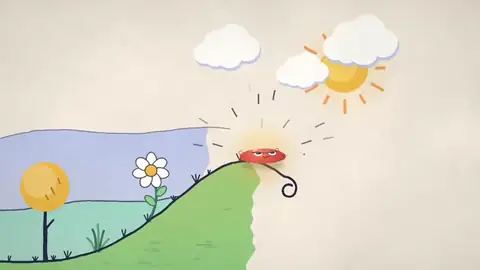 | — | Fable 5.5 作品混剪 | @yihui_indie | — | — | 286.933s | 2026-10-05 | [Link](https://x.com/yihui_indie/status/2107097706661560595) |
| 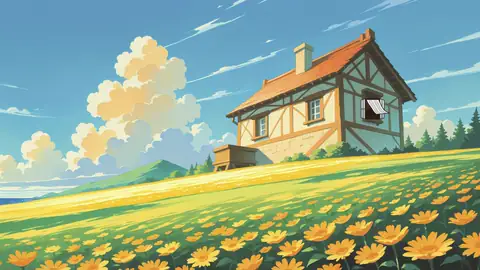 | Initial | Clockwork Bird | @camperaigg | 1h54m | ~$20 | 60s | 2026-11-03 | [Link](https://x.com/camperaigg/status/2117666378174050352) |
| 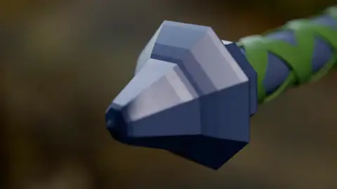 | Part 2 | Link's Master Sword | @camperaigg | 32min+ | $11.66 | 34s | 2026-11-03 | [Link](https://x.com/camperaigg/status/2117694354685092255) |
| 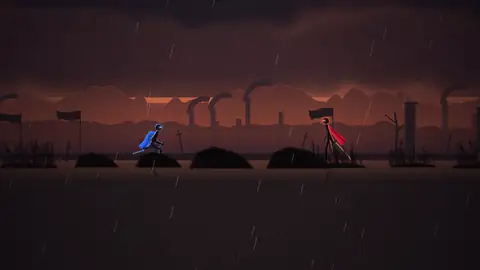 | Part 3 | Anime Stickman Sword Fight | @camperaigg | 66min | $15.71 | 46s | 2026-11-03 | [Link](https://x.com/camperaigg/status/2117717189059026969) |
| 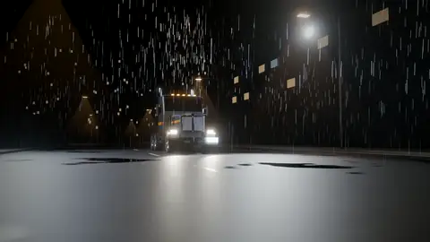 | Part 4 | Transformer Truck | @camperaigg | 107min | $9.64 | 12.5s | 2026-11-04 | [Link](https://x.com/camperaigg/status/2117914482752299311) |
| 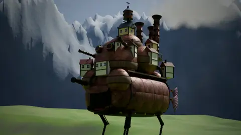 | Part 5 | Howl's Moving Castle | @camperaigg | 133min | $12.37 | 35s | 2026-11-04 | [Link](https://x.com/camperaigg/status/2117966825048997914) |
| 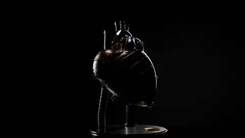 | Part 6 | Mechanical Heart | @camperaigg | 106min | $12.35 | 30s | 2026-11-04 | [Link](https://x.com/camperaigg/status/2118002649929056373) |
|  | Part 7 | Whale Breach | @camperaigg | 154min | $17.85 | 31s | 2026-11-04 | [Link](https://x.com/camperaigg/status/2118069524306284556) |
## 🎬 Video & Animation

| Preview | Case & Summary | Stack & Status | Prompt / Links |
| :--- | :--- | :--- | :--- |
|  | **Discovering I've been routed to Fable 5.** Discovering I've been routed to Fable 5.5 has led me to comp *By @atomtanstudio (2026-10-05)* | 🏷️ 灰度路由/传闻 | [🔗 Original post](https://x.com/atomtanstudio/status/2106900686764134654) 

View Prompt
<pre>via auto-discovery</pre>
 |
|  | **I asked Fable 5.5 for something cool and** I asked Fable 5.5 for something cool and accurate in an arch *By @nroze22 (2026-10-03)* | 🏷️ 灰度路由/传闻 | [🔗 Original post](https://x.com/nroze22/status/2106183281293381661) 

View Prompt
<pre>via auto-discovery</pre>
 |
|  | **3分钟未来人类进步动画** 仅用一句Prompt生成3分钟动画电影与原创配乐，无素材无库存音乐。 *By @imjustnewatai (2026-10-02)* | 🏷️ 灰度路由/传闻 | [🔗 Original post](https://x.com/imjustnewatai/status/2106081142143168580) 

View Prompt
<pre>a video of all human progress, then 30 years into the future</pre>
 |
|  | **Fable5.5想象HF事故** 结合Blender与ElevenLabs，展现AI创意3D叙事。 *By @chetaslua (2026-10-02)* | `Blender` `ElevenLabs API` 🏷️ 灰度路由/传闻 | [🔗 Original post](https://x.com/chetaslua/status/2105884276864782557) 

View Prompt
<pre>Hugging Face Incident Imagined by Fable 5.5</pre>
 |
|  | **Fable 5.5 作品混剪** 汇总 73 个开源作品，展示 Fable 5.5 的生成能力与持续更新。 *By @yihui_indie (2026-10-05)* | 🏷️ 实测验证 | [🔗 Original post](https://x.com/yihui_indie/status/2107097706661560595) 

View Prompt
<pre>未公开</pre>
 |
|  | **Clockwork Bird** A fully vector clockwork bird assembles itself on camera, with an original waltz and purely math-synthesized sound effects throughout. *By @camperaigg (2026-11-03)* | `Claude Code` `HyperFrames` 🏷️ 实测验证 | [🔗 Original post](https://x.com/camperaigg/status/2117666378174050352) 

View Prompt
<pre>一句提示词（未公开完整原文）</pre>
 |
|  | **Link's Master Sword** Link's Master Sword modeled and filmed by a single Blender script, with an original orchestral score. *By @camperaigg (2026-11-03)* | `Claude Code` `Blender` 🏷️ 实测验证 | [🔗 Original post](https://x.com/camperaigg/status/2117694354685092255) 

View Prompt
<pre>Build Link's Master Sword in Blender（后续追加“make a video of it”）</pre>
 |
|  | **Anime Stickman Sword Fight** Anime-style stickman sword fight: cloth simulation, impact flashes and 228 physics-synced sound effects. *By @camperaigg (2026-11-03)* | `Claude Code` 🏷️ 实测验证 | [🔗 Original post](https://x.com/camperaigg/status/2117717189059026969) 

View Prompt
<pre>Make me a video of 2 stickman fighting, anime style.</pre>
 |
|  | **Transformer Truck** A fully rigged transforming truck with Geometry Nodes rain, ripples and fully synthesized mechanical sounds. *By @camperaigg (2026-11-04)* | `Claude Code` `Blender` 🏷️ 实测验证 | [🔗 Original post](https://x.com/camperaigg/status/2117914482752299311) 

View Prompt
<pre>Make me a transformer truck with animations of its transforming.</pre>
 |
|  | **Howl's Moving Castle** A walking castle: full steam-engine-to-gait modeling with a mid-video shell cutaway. *By @camperaigg (2026-11-04)* | `Claude Code` `Blender` 🏷️ 实测验证 | [🔗 Original post](https://x.com/camperaigg/status/2117966825048997914) 

View Prompt
<pre>Make me Howl's moving castle and also show its internal machinery.</pre>
 |
|  | **Mechanical Heart** A mechanical heart with a cutaway animation: twin-piston crankshaft and a heartbeat-synced score. *By @camperaigg (2026-11-04)* | `Claude Code` `Blender` 🏷️ 实测验证 | [🔗 Original post](https://x.com/camperaigg/status/2118002649929056373) 

View Prompt
<pre>Make a mechanical heart and show its insides, use blender.</pre>
 |
|  | **Whale Breach** A whale breaches a cel-shaded ocean: 16.9M-particle fluid and a 1.09M-triangle whale built purely in code. *By @camperaigg (2026-11-04)* | `Claude Code` 🏷️ 实测验证 | [🔗 Original post](https://x.com/camperaigg/status/2118069524306284556) 

View Prompt
<pre>Make a whale breach a cel-shaded ocean.</pre>
 |
## 📱 Interactive H5 & Apps

| Preview | Case & Summary | Stack & Status | Prompt / Links |
| :--- | :--- | :--- | :--- |
|  | **Fable 5.5 一小时打造游戏** 一次生成宝可梦×Balatro游戏，含机制、视觉、音乐与演示视频。 *By @anshuc (2026-10-05)* | `HTML5` 🏷️ 实测验证 | [🔗 Original post](https://x.com/anshuc/status/2107180724399075488) / [🕹️ Live demo](https://pokermon.anshu.dev) 

View Prompt
<pre>未公开</pre>
 |
|  | **沙漠人造太阳交互场景** 生成沙漠中可移动、调镜、控制日食的人造太阳，光影反射逼真。 *By @pankajkumar_dev (2026-10-04)* | `HTML5` `Canvas` `Three.js` 🏷️ 实测验证 | [🔗 Original post](https://x.com/pankajkumar_dev/status/2106762987872850092) 

View Prompt
<pre>未公开</pre>
 |
## 🎮 Games & Physics

| Preview | Case & Summary | Stack & Status | Prompt / Links |
| :--- | :--- | :--- | :--- |
|  | **Claude 一次生成漂移小游戏** Fable 5.5 单次生成网页漂移游戏，可直接在线试玩体验。 *By @Armaan_Jain123 (2026-10-05)* | `HTML5` 🏷️ 实测验证 | [🔗 Original post](https://x.com/Armaan_Jain123/status/2107251677615300969) / [🕹️ Live demo](https://drift.hexclave.app) 

View Prompt
<pre>未公开</pre>
 |
|  | **一次生成像素Bug游戏** Claude 一次生成 Clawd 打Bug与Boss 的像素游戏，体验接近人类独立开发者。 *By @blueemi99 (2026-10-05)* | `HTML5` `Canvas` `JavaScript` 🏷️ 实测验证 | [🔗 Original post](https://x.com/blueemi99/status/2107108802440900621) / [🕹️ Live demo](https://claude.ai/artifact/Bor4eKVfaKakr6QSfoT8UZ) 

View Prompt
<pre>made me this pixel game where u play as Clawd, defeating bugs and bosses</pre>
 |
|  | **三体问题60帧渲染** 一次生成约1000行代码，CPU辛物理、GPU像素计算，并形式化证明程序定律。 *By @zAdrielsan (2026-10-02)* | `HTML5` `GPU` `WebGL` 🏷️ 实测验证 | [🔗 Original post](https://x.com/zAdrielsan/status/2105822678519001360) 

View Prompt
<pre>Asked Fable 5.5 for the three-body problem. One-shot.</pre>
 |
|  | **Waymo驶过旧金山地标街** 用Fable 5.5与Three.js实现Lombard Street驾驶场景，具强空间感与交互性。 *By @mindblown_ai (2026-10-02)* | `Three.js` `HTML5` 🏷️ 实测验证 | [🔗 Original post](https://x.com/mindblown_ai/status/2106112279079199037) / [🕹️ Live demo](https://teleoperator.mindblown.ai) 

View Prompt
<pre>未公开</pre>
 |
## Detailed Notes
### Initial: Clockwork Bird
- **Post**: [https://x.com/camperaigg/status/2117666378174050352](https://x.com/camperaigg/status/2117666378174050352) · **Time**: 1h54m · **Cost**: ~$20 · **Length**: 60s- **Prompt**: 一句提示词（未公开完整原文）
- **Highlights**: Vector clockwork-bird parts fly in and assemble; one continuous shot; Original waltz score throughout; Purely math-synthesized SFX, frame-accurate to ±5ms
### Part 2: Link's Master Sword
- **Post**: [https://x.com/camperaigg/status/2117694354685092255](https://x.com/camperaigg/status/2117694354685092255) · **Time**: 32min+ · **Cost**: $11.66 · **Length**: 34s- **Prompt**: Build Link's Master Sword in Blender（后续追加“make a video of it”）
- **Highlights**: Complete single-script modeling (Triforce relief, braided grip, layered feather guard); Automatic z-fighting fixes; Continuous camera move, forest lighting, original orchestral score
### Part 3: Anime Stickman Sword Fight
- **Post**: [https://x.com/camperaigg/status/2117717189059026969](https://x.com/camperaigg/status/2117717189059026969) · **Time**: 66min · **Cost**: $15.71 · **Length**: 46s- **Prompt**: Make me a video of 2 stickman fighting, anime style.
- **Highlights**: Rigged bones + 120Hz cloth; lightning katana vs flame greatsword; One-frame impact flashes (mono/inverted/duotone); Original 120BPM score with 16 instruments; 228 physics-synced SFX (79 auto-detected from sword-tip velocity); Full silence right before the climax
### Part 4: Transformer Truck
- **Post**: [https://x.com/camperaigg/status/2117914482752299311](https://x.com/camperaigg/status/2117914482752299311) · **Time**: 107min · **Cost**: $9.64 · **Length**: 12.5s- **Prompt**: Make me a transformer truck with animations of its transforming.
- **Highlights**: 51-joint rig with ground solving; Geometry Nodes rain and ripples; 64 fully synthesized SFX (diesel, air brakes, servos)
### Part 5: Howl's Moving Castle
- **Post**: [https://x.com/camperaigg/status/2117966825048997914](https://x.com/camperaigg/status/2117966825048997914) · **Time**: 133min · **Cost**: $12.37 · **Length**: 35s- **Prompt**: Make me Howl's moving castle and also show its internal machinery.
- **Highlights**: Complete steam engine → gear train → four-legged gait (solved from the planted foot); Mid-video shell cutaway; Waltz-exact stepping (1.4s/beat); Self-detected and optimized grass rendering (9.3s → 4.2s/frame)
### Part 6: Mechanical Heart
- **Post**: [https://x.com/camperaigg/status/2118002649929056373](https://x.com/camperaigg/status/2118002649929056373) · **Time**: 106min · **Cost**: $12.35 · **Length**: 30s- **Prompt**: Make a mechanical heart and show its insides, use blender.
- **Highlights**: Twin-piston crankshaft, shell-opening animation; Golden oil bubbles and drips; Heartbeat-synced score; Self-diagnosed hidden lighting issue
### Part 7: Whale Breach
- **Post**: [https://x.com/camperaigg/status/2118069524306284556](https://x.com/camperaigg/status/2118069524306284556) · **Time**: 154min · **Cost**: $17.85 · **Length**: 31s- **Prompt**: Make a whale breach a cel-shaded ocean.
- **Highlights**: 16.9M-particle fluid (1200 steps/s); Three-layer FFT waves + cel shading; 1.09M-triangle whale built purely in code; Underwater optics (Snell's window); Self-detected and re-rendered intersection artifacts
## Related Resources
- Other Fable 5.5 community collections: [awesome-fable5-5-videos](https://github.com/billyhetech/awesome-fable5-5-videos), [awesome-fable-5.5-usecase](https://github.com/coolbat/awesome-fable-5.5-usecase)

## Notes & Copyright
- All videos and descriptions come from the authors' public posts; please refer to the originals.
- The index itself is released under the [MIT License](LICENSE); the linked posts and videos belong to their original authors.
- Seed cases are @camperaigg's Fable 5.5 Testing Series (Parts 1–7).
