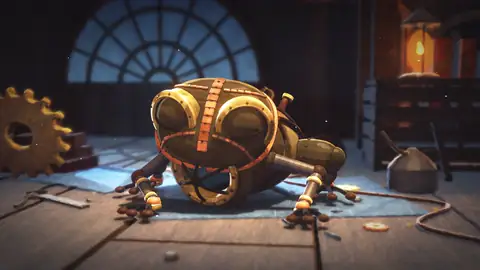

[中文](README.md) | **English**

# Fable 5.5 Testing Series — Claude Fable 5.5 Hands-on Case Index

An index of single-prompt animation, 3D and interactive tests of **Claude Fable 5.5** posted on X (Twitter): links, prompts, build time & cost, and result highlights — all in one place.

> **Note**: As of November 2026, Fable 5.5 has not been officially released by Anthropic. Everything below is early-access / routing reports; please refer to the original posts.
> This repository is an index only. Each preview is a WebP animation of the first 5 seconds of the original video; see the original post for the full piece. All posts and videos belong to their respective authors.

> 💡 **Contribute**: Open an [Issue](../../issues/new?template=submit_case.yml) (the form auto-applies the `submission` label) and paste a tweet link — GitHub Actions will parse, classify and add it to this page and to `data/cases.json` automatically.

## Overview

| Preview | Part | Title | Author | Time | Cost | Length | Date | Post |
| :--- | :--- | :--- | :--- | :--- | :--- | :--- | :--- | :--- |
|  | — | One-Prompt Animation With Self-Written Renderer | @ChrisGPT | — | — | 9s | 2026-11-02 | [Link](https://x.com/ChrisGPT/status/2117381015069212910) |
|  | — | GTA-6 Browser Game in 40 Minutes | @zodchiii | — | — | 50.533s | 2026-11-04 | [Link](https://x.com/zodchiii/status/2117978323343360245) |
|  | — | 83-Second Anime Film in Pure Three.js | @0xMovez | — | — | 83s | 2026-11-04 | [Link](https://x.com/0xMovez/status/2117987052419428576) |
|  | — | One-Prompt 42s Apocalyptic Robot Animation | @ka1manov | — | — | 42s | 2026-11-04 | [Link](https://x.com/ka1manov/status/2118045185972314232) |
|  | — | One-Prompt Jupiter Core Flythrough in One Take | @camperaigg | — | — | 46s | 2026-11-05 | [Link](https://x.com/camperaigg/status/2118246310981910811) |
|  | — | Rowing Into a 31m Wave | @camperaigg | — | — | 35.008s | 2026-11-05 | [Link](https://x.com/camperaigg/status/2118317021935071339) |
|  | — | Best Voxel Pagoda Garden Yet | @legit_api | — | — | 108.083s | 2026-11-04 | [Link](https://x.com/legit_api/status/2117994730336252114) |
|  | — | Animation Video Produced Entirely by Code | @devteamdrew | — | — | 100.083s | 2026-11-04 | [Link](https://x.com/devteamdrew/status/2118008142403649662) |
|  | — | Fable 5.5 One-Shot Minecraft | @notjazii | — | — | 91.8s | 2026-11-01 | [Link](https://x.com/notjazii/status/2116919129974411584) |
|  | — | The Last Page Ghibli-Style Short | @chetaslua | — | — | — | 2026-11-02 | [Link](https://x.com/chetaslua/status/2117224843661980093) |
|  | — | Pure Code Animation | @notjazii | — | — | 262.566s | 2026-11-02 | [Link](https://x.com/notjazii/status/2117221957104239010) |
|  | — | Zero Image Model Animated Short | @chetaslua | — | — | 58.453s | 2026-11-02 | [Link](https://x.com/chetaslua/status/2117224839010459987) |
|  | — | Fable 5.5 Combat Animation | @notjazii | — | — | 30.046s | 2026-11-02 | [Link](https://x.com/notjazii/status/2117261864904351848) |
|  | — | GTA 6 SVG Beach Animation | @imjustnewatai | — | — | 21.385s | 2026-11-03 | [Link](https://x.com/imjustnewatai/status/2117678536794296462) |
|  | — | Life Tree Code Animation | @notjazii | — | — | 30s | 2026-11-04 | [Link](https://x.com/notjazii/status/2117972258090357164) |
|  | — | One-Shot 42s Anime with Fable | @0xMovez | — | — | 42s | 2026-11-03 | [Link](https://x.com/0xmovez/status/2117700681867903169) |
|  | — | Code-Based Video Beats AI Models | @chetaslua | — | — | 80.666s | 2026-11-02 | [Link](https://x.com/chetaslua/status/2117169796290916732) |
|  | Initial | Clockwork Bird | @camperaigg | 1h54m | ~$20 | 60s | 2026-11-03 | [Link](https://x.com/camperaigg/status/2117666378174050352) |
|  | Part 2 | Link's Master Sword | @camperaigg | 32min+ | $11.66 | 34s | 2026-11-03 | [Link](https://x.com/camperaigg/status/2117694354685092255) |
|  | Part 3 | Anime Stickman Sword Fight | @camperaigg | 66min | $15.71 | 46s | 2026-11-03 | [Link](https://x.com/camperaigg/status/2117717189059026969) |
|  | Part 4 | Transformer Truck | @camperaigg | 107min | $9.64 | 12.5s | 2026-11-04 | [Link](https://x.com/camperaigg/status/2117914482752299311) |
|  | Part 5 | Howl's Moving Castle | @camperaigg | 133min | $12.37 | 35s | 2026-11-04 | [Link](https://x.com/camperaigg/status/2117966825048997914) |
|  | Part 6 | Mechanical Heart | @camperaigg | 106min | $12.35 | 30s | 2026-11-04 | [Link](https://x.com/camperaigg/status/2118002649929056373) |
|  | Part 7 | Whale Breach | @camperaigg | 154min | $17.85 | 31s | 2026-11-04 | [Link](https://x.com/camperaigg/status/2118069524306284556) |
## 🎬 Video & Animation

| Preview | Case & Summary | Stack & Status | Prompt / Links |
| :--- | :--- | :--- | :--- |
|  | **One-Prompt Animation With Self-Written Renderer** A single prompt produced a fully animated short with custom renderer, hand-painted textures and synthesized audio, no GPU or external assets. *By @ChrisGPT (2026-11-02)* | `自研渲染器` `程序化纹理绘制` `2s 逐帧动画` `音效合成` 🏷️ 实测验证 | [🔗 Original post](https://x.com/ChrisGPT/status/2117381015069212910) 

View Prompt
<pre>未公开</pre>
 |
|  | **83-Second Anime Film in Pure Three.js** One-shot 83-second film in under 3 hours using pure Three.js, 39 shots, 1,992 rendered frames, synthesized audio, single offline HTML file. *By @0xMovez (2026-11-04)* | `Three.js` `HTML5` `Web Audio API` 🏷️ 实测验证 | [🔗 Original post](https://x.com/0xMovez/status/2117987052419428576) 

View Prompt
<pre>Create a 2D anime short for the web. It must look completely like real Japanese anime, as if it were taken directly from a finished theatrical anime film. This is traditional-looking, hand-drawn 2D anime, not a 3D animation, a moving illustration, or a stylized web graphic.  Deliver the final result as a single, self-contained HTML file that plays offline, with a synthesized soundtrack. Use any tools, libraries, references, guides, literally anything etc.  Use theatrical mecha and kaiju anime as the art style reference for the design, line work, painted backgrounds, color, and atmosphere. The film is 83 seconds long, in 39 shots. Its characters are a colossal silver archer robot, a fleet of container ships, and a leviathan. No people appear in the film. Use any tools or techniques you want, including 3D, as long as the final result looks 100% like hand-drawn 2D anime.  SCENE  A blazing sunny day on a coast. A massive armored archer robot, a hundred meters tall, stands in a deep lunge on a headland and draws a bow taller than itself. Close-ups: the hand on the grip, the limb and cable, the foot planted in the surf. Blue energy crawls along the arrow into the chest armor until the arrowhead blazes like crystal. The string snaps forward and a shockwave flattens the sea. The arrow is a harpoon trailing a thin cable. It tears the clouds into two walls above a ship's deck, climbs through the cloud tops, and reaches the edge of space in a blue flash along the planet's limb.  Out at sea, container ships cross a colossal shadow. Four humpback whales breach beside a ship, with real arcs and full tail flukes, and dive tail last. From below, shapes move under the bright churning surface. Four whale heads rise from a boiling sea, and a ring of teeth rises around them: they are lures inside a mouth. They drop in and the jaws shut. The leviathan breaches through the fleet in one slow, enormous arc. Its belly slides past the bridge windows. The swell it leaves lifts the ships and stands one on end, spilling containers. Its ridged back and flukes sink into spray fog. High above, the arrow turns over and comes back red-hot through the atmosphere. Below the surface, the leviathan crawls through a luminous canyon on clawed forelimbs and swallows a fleeing whale. A thin streak meets the sea on the horizon and a white plume swells up. The harpoon drives through its back in a blue-white flash, lightning runs along its body, and the barbed tip punches out of its belly into the rock, which bursts apart. The cable stays attached the whole time, rising to the surface. A mountain of water swells from the sea. The dying leviathan erupts, rolls over between the ships and falls, and a wall of water takes the fleet.  ANIME QUALITY STANDARD  Every frame must look as if it was drawn by professional anime animators and painted by master background artists for a finished theatrical film.  Archer: A massive, heavy anime mecha with sculpted overlapping armor plates, panel lines, bolts, markings and a faceted chest reactor that glows blue. Hands really grip the bow and string. The arrow never passes through the armor. Keep it on-model from every angle.  Leviathan: Whale-like and colossal, always dwarfing the ships. Rough, dark grey-teal wet hide with barnacles and scars, a pale ribbed throat, a spined back, huge clawed flippers, and a cavernous maw with uneven teeth. A real bending body with weight, never a stiff model hanging on pillars of water. Whales: Real humpback anatomy with tail stock, big notched flukes and long curved flippers rooted in the body.  Ships: Detailed container ships with corrugated multicolor containers, lashing bars and a white bridge tower.  Line art: Confident, delicate, hand-inked anime line work with subtle variation in thickness and pressure. Coloring: Traditional anime cel coloring with clean color areas, hard-edged cool lavender-blue shadows, crisp highlights, and a bright, high-key, saturated palette. Never gloomy, grey or muddy, even in the darkest moments of the story.  Backgrounds: Richly detailed, hand-painted anime backgrounds in a gouache style: towering white cumulus, a cobalt-to-turquoise sea at kilometer scale, a painted coast with a far town, Earth from orbit, a port city from the stratosphere.  Underwater: Luminous cyan depth with god rays, a rippling surface seen from below, jagged canyon rock, silt and fish. Bright, not black.  Lighting: Summer sun with colorful shadows, and a separate character key light so that nothing sinks into shade.  Effects: Bold drawn anime FX on twos and threes. Sharp lightning with a white core, plasma trails, sheets of water pouring off the body, plumes, spray and a wall of water with real mass. Never particle mush or cotton-wool clouds.  Animation: Authentic hand-drawn anime timing, with characters on twos, strong key poses, natural holds, and overlapping movement. Huge things move slowly and heavily. Nothing clips, slides or floats.  Sound: An original epic score with ominous drones, brass and choir, near silence before the impact, then a colossal hit. Add a recurring whale-song motif, bow creak, charge whine, sonic boom, thunder and the sea, muffled underwater, all timed to the picture. Direction: Cinematic shots, macro close-ups against huge wide shots, thoughtful staging, and pacing that builds from quiet tension to a devastating climax.  IT MUST NOT LOOK LIKE  - 3D: No plastic materials, CGI shading, visible polygons, game-engine lighting, or computer-perfect perspective. - Blocky "Minecraft" shapes: No plain boxes, empty flat surfaces, or toy-like proportions. Every surface carries design detail. - SVG or vector art: No simple geometric shapes, perfect curves, uniform outlines, flat corporate illustration, or basic gradients. - Web animation: No sliding layers, constant bobbing, floating parts, smooth software easing, or puppet-like joint rotation. - Pasted-on elements: No 2D sprites floating in a 3D scene. - AI art: No warped shapes, melted details, flickering, or changing designs. - Non-anime art: No Western cartoon designs, realistic rendering, soft painterly shading on the characters, or generic digital illustration. - Amateur work: No stiff poses, empty backgrounds, muddy colors, clip art, placeholders, or unfinished details.  You are free to change any part of the prompt, if it would result in better results.  The result should feel enormous, terrifying and beautiful, a blockbuster in bright anime colors.   Before finishing, inspect random frames as still images. If any frame does not look completely like real 2D anime, keep improving it.   Do not stop until every frame could pass as a still from a theatrical anime film.</pre>
 |
|  | **One-Prompt 42s Apocalyptic Robot Animation** Fable 5.5 generated a 42-second apocalyptic robot animation from one prompt, reportedly outperforming 90% of video models. *By @ka1manov (2026-11-04)* | `Fable 5.5` 🏷️ 实测验证 | [🔗 Original post](https://x.com/ka1manov/status/2118045185972314232) 

View Prompt
<pre>Make a video animation of apocalyptic worlds with robots</pre>
 |
|  | **One-Prompt Jupiter Core Flythrough in One Take** Single prompt produced a 46-second one-take Jupiter flythrough with custom fluid sim and score. *By @camperaigg (2026-11-05)* | `three.js` `Python` 🏷️ 实测验证 | [🔗 Original post](https://x.com/camperaigg/status/2118246310981910811) 

View Prompt
<pre>Fly a camera straight through Jupiter's core.</pre>
 |
|  | **Rowing Into a 31m Wave** One prompt produced a 35s 1080p60 one-take storm-wave rowing animation with Three.js. *By @camperaigg (2026-11-05)* | `Three.js` `Python` `Claude Code` 🏷️ 实测验证 | [🔗 Original post](https://x.com/camperaigg/status/2118317021935071339) 

View Prompt
<pre>I asked Claude to row me into a 31 m wave in a lightning storm.</pre>
 |
|  | **Animation Video Produced Entirely by Code** Full animation video rendered frame-by-frame with JS and Python by multi-agent teams over 19 hours, no video or image models used. *By @devteamdrew (2026-11-04)* | `JavaScript` `Python` 🏷️ 实测验证 | [🔗 Original post](https://x.com/devteamdrew/status/2118008142403649662) 

View Prompt
<pre>Create a complete, 100-second, 2D anime short film, drawn and animated entirely in code for the web. It must look exactly like real Japanese theatrical anime, as if every frame were lifted from a finished Studio Ghibli feature with a 500-million-dollar budget. This is traditional-looking, hand-drawn 2D anime: not 3D animation, not a moving illustration, not a stylised web graphic, not AI art.  Deliver it as self-contained HTML/JavaScript scenes that render every frame deterministically to a canvas, plus a render pipeline that exports each frame to PNG and encodes the final film at 1920x1080, 48 frames per second. Use any tools, libraries, references, simulations or techniques you want, including 3D maths, fluid simulation and depth buffers, as long as the final image looks 100% like hand-drawn and hand-painted 2D anime. Draw everything in code. No AI-generated images, no stock footage, no traced photographs.  Use Studio Ghibli films (Laputa, Nausicaa, Porco Rosso, Howl's Moving Castle, Spirited Away, The Wind Rises) as the reference for design, line work, painted backgrounds, colour, light and atmosphere, and Studio Trigger for the confidence of the key poses and the punch of the big moments. Study real humpback and blue whale motion for every movement of the main character. No people appear in the film.  THE MAIN CHARACTER: THE OLD WHALE An ancient sky-whale that is also an airship: a creature and a vessel at once, so old that the two have grown together. About 120 metres long. - Hull: overlapping riveted plates in weathered teal and sea-green, chipped and patched, with rust blooms in burnt orange and red, every seam and rivet crisp. A cream, ribbed keel runs along the belly like the planking of an old boat. - Back: a hanging garden. Moss beds, sod clumps, wildflowers, one wind-bent pine tree and small shrubs ride on its back, with a weathered mast, rigging lines and long faded pennants that stream in the wind. - Fins: great fan-shaped pectoral fins built like junk sails, with wooden spars and cream sailcloth painted with red stripes, opening and closing like breath. - Eye: a round brass porthole with a warm amber glow; its light is the whale's emotion. - Breath: a blowhole vent that exhales a plume of warm vapour, like steam from an old engine. - Tail: a broad fluke whose stroke drives the whole body. It must stay perfectly on-model from every angle and distance, from a 900-pixel close-up to a 40-pixel speck in an extreme wide.  THE POD (night only) Five more sky-whales of the same kind, each with its own silhouette and personality, each with a glowing amber eye: Drover (large, heavy, tall sails), Pip (small and young), Elder (very old, carrying a big pine and a dense garden), Mend (patched and gentle) and Swift (lean and fast, the one who leaps).  THE FILM: FIVE MOVEMENTS, ONE JOURNEY (one day, dawn to night)  I. DAWN: THE BREAKOUT (21.0 s, one continuous take, no cuts) Open on a vast, scenic sky at first light: a sea of cloud below, pale gold on the horizon, silence. Hold long enough to breathe. Then the cloud sea begins to swell and bulge. Something enormous is rising underneath. The Old Whale breaks out slowly and majestically: the cloud domes, tears and parts along its snout first, then its brow, then its garden. Real cloud physics: vapour pushed aside by a moving solid, rolling collars, torn edges, sheets of cloud sliding off the hull and fraying into strands, a wake closing behind. The fins open, the pine tree sways, the pennants unfurl, the eye catches the sun, and the whale breaches into the golden sky. The camera is a single unbroken crane move: it starts low near the cloud surface, rises with the whale and pulls back to reveal its full scale against the sunrise. Slow, heavy, inevitable, then soaring.  II. MORNING: THE CROSSING (19.0 s, three shots) The whale crosses a vast valley in clean morning light. A wide from high above: a patchwork world of fields, forests, a winding river and hills a kilometre below, painted like a Ghibli background, with the whale small and swimming above it. Then a close shot of a great fin stroking through the air, every spar and stripe crisp. Then the whale enters a towering cream cloud bank: the cloud must swallow the hull AND everything on its back together. Nothing on the whale may ever show through a cloud that is in front of it.  III. STORM: THE SQUALL (18.0 s) The whale flies into a storm. The light dies to slate blue and grey. Rain streaks across the frame. Inside the storm cloud the whale labours through the gloom, and lightning cracks: each strike must light the whale itself, a hard rim of white light along the hull and fins and a lit silhouette, with the cloud interiors flashing from within. Not a flat brightness flicker. Then the whale bursts out of the top of the storm: the cloud is ripped open, torn edges, shadowed interiors with structure and light pouring through the tear, and the whale lifts clear into the sunlight under a rainbow, cream and lilac cloud falling away below it. Relief.  IV. DUSK: THE CALLING (17.6 s, two shots joined by a hard cut) A calm sea at dusk. Sky from apricot (#f2b27a) to rose (#c78aa0), the low sun laying a road of light on the water, violet shadows (#6f5f86). The whale floats low over the smooth sea, its reflection beneath it. It draws a breath and blows: a soft, translucent plume of vapour, never a solid cut-out. Then it calls, head lifting, eye brightening. Then the "ma": a true held stillness, only the gentlest breath of life, while the call hangs in the air. And then a HARD CUT ON THE SILENCE, Ghibli-style, to an extreme lonely wide: the same sky, the same sun at the same height, the same world, but the whale is now tiny on an endless sea. It swims, not slides, slowly across the sun's path on the water, each fluke stroke surging it forward, its reflection trailing beneath. No answer comes.  V. NIGHT: THE ANSWER (24.5 s) Moonlight on a sea of cloud in indigo and lilac, stars, a full moon. The camera is locked off at first, and the Old Whale crosses the frame alone. A close shot as it sings its song under the moon. Far away, warm points of light appear along the distant cloud band: eyes. Then, one by one, the pod rises out of the cloud sea: the cloud heaves ahead of each snout, parts from snout to tail, a collar of cloud forms behind and rolls out, cel-painted sheets of cloud slide off each hull and fray away, and the opening heals slowly behind. Drover, then Pip and Elder, then Mend, then Swift leaping clear. The Old Whale swims into the pod. The camera pulls back, slowly and not too far, so that the whole family stays big and readable in the frame, on top of the cloud sea and never buried in it, and together they swim toward the moon. Hold on the final image until it settles.  THE ANIME QUALITY STANDARD Every frame must look as if it was drawn by professional anime animators and painted by master background artists for a finished theatrical film. - Line art: confident, hand-inked line work with real variation in weight and pressure, heavier on the silhouette, delicate inside. The ink must be stable from frame to frame and must never re-roll, boil or switch between single and double lines. - Colour: traditional cel colouring with clean colour areas and simple hard-edged shadows (kage) tinted toward the sky's fill light, never grey. - Light: a cel rim of light inside the ink on every sun-facing or moon-facing edge, light wrap from the real background around the silhouette, a scene key that multiplies through the character, and atmospheric haze with real depth. - Backgrounds: richly detailed, hand-painted gouache backgrounds with visible brushwork, natural colour variation, layered depth and no repeated elements. The whale is the subject; backgrounds support it and never compete with it. - Clouds: the heart of this film. Painted like Ghibli clouds (soft, massive, sculpted forms with warm tops and cool bellies), but moving like real vapour: a 3D fluid with the whale as a moving solid inside it, parting, rolling, tearing and healing. Never a rigid lump, never glassy ovals, never a flat cream blanket, never cloud pieces that pop on or swap order in a single frame. - Finish: the final finishing layer of a theatrical release: crisp ink, clear cel light, rich but controlled colour, density instead of brightening contrast, light-side diffusion and a fine film grain that changes on a 24 Hz cycle. - Motion: real weight and whale-like movement. The whale moves on every single frame at 48 fps with smooth, heavy, eased motion; every fin, pennant, pine branch and sail has overlapping action and follow-through. Hand-drawn texture and grain update on twos (24 Hz) so the image keeps its drawn feel. - Direction: cinematic anime staging and composition, deliberate camera grammar (a crane, locked-off wides, a pull-back, a hard cut used only where it means something), and pacing that starts quietly, builds, breaks open in the storm, falls to silence at dusk and resolves at night.  THE SOUND - Score: an original orchestral score in the register of Joe Hisaishi, played on real sampled instruments only (strings, woodwinds, horn, piano, percussion; VSCO 2 Community Edition and the Salamander Grand Piano, rendered through sfizz). A short motif (D, A, B in D major pentatonic) is the whale's character and carries through all five movements: a swelling bloom as the whale breaches at dawn, open and lyrical across the valley, tense and restrained in the storm, withdrawn to nothing at dusk, and returned warmly as the pod answers at night. Three or four voices at a time, sparse, intentional, always leaving room for the whale. - Whale voices: built from real humpback recordings blended with mechanical tones (brass valves, steam, creaking timber), so they sound like a living creature that is also a ship: waking songs, the dusk call, breaths from brass vents and steaming lungs, contented hums, effort groans, and a distinct voice for each pod whale. Use them intentionally, never everywhere. - Air: wind and whooshes only as extremely subtle accents on fins, the storm burst and far cloud-breaks. No wind beds, no room tone. - Depth: place every sound at its on-screen distance. Near sounds are full and wide, far sounds are quieter, darker, more reverberant and narrower, sounds inside cloud are muffled, and the sound perspective changes at each cut. The music holds one steady, near distance. - Silence: true digital silence where the film is silent, especially across the hard cut at dusk. - Loudness: very quiet and intimate, about -32 LUFS integrated, true peak no higher than -3 dBTP.  IT MUST NOT LOOK LIKE - 3D: no plastic materials, CGI shading, visible polygons, game-engine lighting or computer-perfect perspective. - SVG or vector art: no simple geometric shapes, perfect curves, uniform outlines, flat corporate illustration or basic gradients. - Web animation: no sliding layers, constant bobbing, floating parts, a whale that slides instead of swims, a whale pinned to the same spot on screen, or puppet-like joint rotation. - AI art: no warped shapes, melted details, flickering, boiling textures or a changing whale design. - Glitches: no decor that flickers or pops in and out, nothing on the whale's back showing through cloud in front of it, no cloud shards popping on and off, no sky or sea that stutters while the whale moves, no hard rectangular shadow edges, no ghosting dissolves, no stray white lines that don't belong to the world. - Non-anime art: no Western cartoon designs, realistic rendering, soft painterly shading on the whale or generic digital illustration. - Amateur work: no stiff poses, empty backgrounds, repeated elements, muddy colours, placeholders or unfinished details. - Bad sound: no synth pads, no procedural tones, no AI-generated audio, no harp, nothing loud.  PROCESS Design first: lock a model sheet for the Old Whale and the five pod whales before any animation. Then style frames per movement, then motion tests, then full movements. Before finishing, inspect random frames as still images and every frame at full rate for flicker and pops. Have fresh eyes review every render. If any frame does not look completely like a still from a theatrical anime film, keep improving it. Do not stop until every frame could pass as one.  The result should feel awe-inspiring, nostalgic and full of wonder: a lonely old giant of the sky calling out across the world at the end of the day, and finally being answered.</pre>
 |
| No preview | **The Last Page Ghibli-Style Short** A 60-second hand-drawn 2D anime short about a fox waking a forgotten library, with cinematic Ghibli aesthetics and original score. *By @chetaslua (2026-11-02)* | `HTML5` `Web Audio` 🏷️ 实测验证 | [🔗 Original post](https://x.com/chetaslua/status/2117224843661980093) 

View Prompt
<pre>Create a launch film for Fable 5.5 as a 2D anime short for the web. It must look completely like real Japanese anime, as if it were taken directly from a finished theatrical anime film. This is traditional-looking, hand-drawn 2D anime, not a 3D animation, a moving illustration, a stylized web graphic, or a tech-company product ad.  Deliver the final result as a single, self-contained HTML file with sound. Use any tools, libraries, references, guides, literally anything. Pre-rendering the film and embedding it in the file is allowed. All artwork and audio must be original. The page should be a black, letterboxed cinema frame with one quiet play button (browsers block autoplay with sound) and nothing else on screen.  Use Studio Ghibli films as the art style reference for the design, line work, painted backgrounds, color, and atmosphere, without copying any existing character or shot. No people appear in the film. The main character is an original small red fox, because fables have always been told through animals. Use any tools or techniques you want, including 3D for layout, as long as the final result looks 100% like hand-drawn 2D anime.  THE FILM: "THE LAST PAGE" (about 60 seconds, 24 fps)  The idea: Fable means story. A forgotten library holds every story ever written, and it has been asleep for a very long time. One small fox wakes it up.  Shot 1, Before Dawn (0:00–0:07). Black. The sound of wind comes first. Fade up on a vast blue-violet sea of clouds at the last hour of night. An ancient stone library tower stands on a cliff above the clouds, with a cracked copper dome gone green, wrapped in ivy and old pines. One small warm light moves across a window. Pampas grass sways in the foreground. Almost nothing else moves. Hold.  Shot 2, The Reading Hall (0:07–0:14). Inside, shelves climb into darkness, holding thousands of unique books: leaning, sagging, sun-faded, some with moss growing along the spines. Moonlight falls in one dusty shaft. Tiny against all of this, the fox pads in from the left, carrying a small paper lantern in its mouth. It stops, sets the lantern down, and looks up.  Shot 3, The Fox (0:14–0:18). Close-up. Ears swivel one at a time. It sniffs, then blinks, a real anime blink with a hold on the closed frame. Lantern light shows in its eyes. It is curious and a little afraid, and the audience should fall in love with it here.  Shot 4, The Blank Book (0:18–0:25). An enormous open book rests on a lectern, its pages empty and yellowed. The fox hops up and places one paw on the page. Silence. A single line of ink appears under the paw and begins to draw itself in one confident brushstroke. It becomes a tiny sketched bird. The bird shivers, then peels off the page and flaps into the air, still made of ink and paper.  Shot 5, The Library Stirs (0:25–0:32). A book on a high shelf trembles. Then a whole row. Dust sifts down in thin streams. A deep, low creak travels up through the tower. The lantern flame leans sideways with no wind to move it. The fox flattens its ears. Cut between shelves on hard, held key poses as the tension builds. Hold one beat of total stillness.  Shot 6, The Pages Burst (0:32–0:39). Every book flies open at once. Thousands of pages tear free, folding into paper birds mid-air on sharp drawn frames. Cut to a dramatic low angle looking straight up the circular stairwell as the flock spirals in a huge rising vortex toward the dome. The dome's old copper shutters break open and the first gold light crashes down the shaft.  Shot 7, Sunrise (0:39–0:44). Outside, the sun clears the sea of clouds. The fox has climbed out onto a stone balcony, fur and grass whipping in the wind, tiny against the sky. It looks up with its mouth slightly open. A great ring of wind rolls outward across the clouds.  Shot 8, The Great Bird (0:44–0:52). This is the climax. High in the golden sky, the flock pulls together into one colossal bird made of a hundred thousand pages, with handwriting and old illustrations visible across its wings. It gives one enormous wingbeat with real weight, then tears across the sky in a sweeping arc, leaving a curving trail of light, mist, and loose paper. Make this the widest, most awe-inspiring image in the film.  Shot 9, The Last Page (0:52–1:00). Quiet returns. Pages spiral down through sunbeams onto the balcony. One lands at the fox's paws. It is the only page still blank. The fox looks at it, then at us, and places its paw down. Ink blooms from under the paw and writes, in one hand-brushed stroke:  Fable 5.5  Below it, a small red hanko seal reading 寓話 presses into the paper, followed by one line in smaller brushed lettering: "Every story begins with a blank page."  Hold on the title. The fox's tail flicks once. Fade to paper, then black. Do not add logos, feature lists, benchmarks, or any product claims.  ANIME QUALITY STANDARD Every frame must look as if it was drawn by professional anime animators and painted by master background artists for a finished theatrical film.  Fox: A hand-drawn anime character with a simple, appealing, solid design, cel-colored forms, and clear silhouettes. Keep it on-model from every angle, and let its ears, tail, posture, and eyes express emotion without any words. Paper birds and the great bird: Hand-drawn with real paper character, including creases, curled corners, and faded ink. The great bird must keep a consistent design and feel immense. Line art: Confident, delicate, hand-inked anime line work with subtle variation in thickness and pressure. Coloring: Traditional anime cel coloring with clean color areas, simple hard-edged shadows, and a soft, natural palette. Backgrounds: Richly detailed, hand-painted anime backgrounds in a gouache style, with visible brushwork, natural color variation, layered depth, and individually considered books, stones, foliage, and clouds. Lighting: The film travels from cool moonlit blue and warm lantern amber to overwhelming golden sunrise. Use colorful shadows, glowing mist, drifting dust, and soft atmosphere that unite characters and background. Animation: Authentic hand-drawn anime timing, mostly on twos and threes, with real weight, strong key poses, natural holds, smears on the fastest frames, and overlapping movement in fur, grass, ivy, paper, and dust. The film should build slowly, then release with explosive power. Direction: Cinematic anime shots, beautiful composition, thoughtful staging, and pacing that starts quietly, builds tension, and ends in a soaring climax, followed by one small, tender moment. Text: All text must look brushed in ink on paper and appear only in the final shot, with no web fonts sitting on top of the picture.  SOUND Create an original score and sound design, with no borrowed melodies. Start with wind and near-silence, then add a lone felt piano motif when the fox appears. Bring in low strings and creaking wood during the tremor, then a sudden roar of fluttering paper, and a full orchestral swell at sunrise. At the climax, the piano motif returns at full scale. End with a single soft piano note as the ink touches the final page. Sound effects should include paw steps, lantern flame, ink, dust, page rustle, and the huge wingbeat.  IT MUST NOT LOOK LIKE - 3D: No plastic materials, CGI shading, visible polygons, game-engine lighting, or computer-perfect perspective. - SVG or vector art: No simple geometric shapes, perfect curves, uniform outlines, flat corporate illustration, or basic gradients. - Web animation: No sliding layers, constant bobbing, floating parts, smooth software easing, or puppet-like joint rotation. - AI art: No warped shapes, melted details, flickering, garbled text, or changing character designs. - Non-anime art: No Western cartoon designs, realistic rendering, soft painterly shading on the characters, or generic digital illustration. - Tech advertising: No glowing neural networks, circuit patterns, chat bubbles, UI mockups, futuristic HUDs, particle-logo reveals, or typed-out text effects. - Amateur work: No stiff poses, empty backgrounds, repeated books or trees, identical paper birds, muddy colors, clip art, placeholders, or unfinished details.  You are free to change any part of this prompt if it would produce a better result.  The result should feel awe-inspiring, nostalgic, and full of wonder, like the moment a story you loved as a child comes back to you. Before finishing, inspect random frames as still images from every shot. If any frame does not look completely like real 2D anime, keep improving it. Do not stop until every frame could pass as a still from a theatrical anime film.</pre>
 |
|  | **Pure Code Animation** Generated a stunning animation in pure code without external assets within an hour. *By @notjazii (2026-11-02)* | 🏷️ 灰度路由/传闻 | [🔗 Original post](https://x.com/notjazii/status/2117221957104239010) 

View Prompt
<pre>make an animation that makes me feel like it’s agi</pre>
 |
|  | **Zero Image Model Animated Short** Generated a 66-second animated short using self-written Python code without image models. *By @chetaslua (2026-11-02)* | `Python` `HTML5` 🏷️ 实测验证 | [🔗 Original post](https://x.com/chetaslua/status/2117224839010459987) 

View Prompt
<pre>Create a launch film for Fable 5.5 as a 2D anime short for the web. It must look completely like real Japanese anime, as if it were taken directly from a finished theatrical anime film. This is traditional-looking, hand-drawn 2D anime, not a 3D animation, a moving illustration, a stylized web graphic, or a tech-company product ad.  Deliver the final result as a single, self-contained HTML file with sound. Use any tools, libraries, references, guides, literally anything. Pre-rendering the film and embedding it in the file is allowed. All artwork and audio must be original. The page should be a black, letterboxed cinema frame with one quiet play button (browsers block autoplay with sound) and nothing else on screen.  Use Studio Ghibli films as the art style reference for the design, line work, painted backgrounds, color, and atmosphere, without copying any existing character or shot. No people appear in the film. The main character is an original small red fox, because fables have always been told through animals. Use any tools or techniques you want, including 3D for layout, as long as the final result looks 100% like hand-drawn 2D anime.  THE FILM: "THE LAST PAGE" (about 60 seconds, 24 fps)  The idea: Fable means story. A forgotten library holds every story ever written, and it has been asleep for a very long time. One small fox wakes it up.  Shot 1, Before Dawn (0:00–0:07). Black. The sound of wind comes first. Fade up on a vast blue-violet sea of clouds at the last hour of night. An ancient stone library tower stands on a cliff above the clouds, with a cracked copper dome gone green, wrapped in ivy and old pines. One small warm light moves across a window. Pampas grass sways in the foreground. Almost nothing else moves. Hold.  Shot 2, The Reading Hall (0:07–0:14). Inside, shelves climb into darkness, holding thousands of unique books: leaning, sagging, sun-faded, some with moss growing along the spines. Moonlight falls in one dusty shaft. Tiny against all of this, the fox pads in from the left, carrying a small paper lantern in its mouth. It stops, sets the lantern down, and looks up.  Shot 3, The Fox (0:14–0:18). Close-up. Ears swivel one at a time. It sniffs, then blinks, a real anime blink with a hold on the closed frame. Lantern light shows in its eyes. It is curious and a little afraid, and the audience should fall in love with it here.  Shot 4, The Blank Book (0:18–0:25). An enormous open book rests on a lectern, its pages empty and yellowed. The fox hops up and places one paw on the page. Silence. A single line of ink appears under the paw and begins to draw itself in one confident brushstroke. It becomes a tiny sketched bird. The bird shivers, then peels off the page and flaps into the air, still made of ink and paper.  Shot 5, The Library Stirs (0:25–0:32). A book on a high shelf trembles. Then a whole row. Dust sifts down in thin streams. A deep, low creak travels up through the tower. The lantern flame leans sideways with no wind to move it. The fox flattens its ears. Cut between shelves on hard, held key poses as the tension builds. Hold one beat of total stillness.  Shot 6, The Pages Burst (0:32–0:39). Every book flies open at once. Thousands of pages tear free, folding into paper birds mid-air on sharp drawn frames. Cut to a dramatic low angle looking straight up the circular stairwell as the flock spirals in a huge rising vortex toward the dome. The dome's old copper shutters break open and the first gold light crashes down the shaft.  Shot 7, Sunrise (0:39–0:44). Outside, the sun clears the sea of clouds. The fox has climbed out onto a stone balcony, fur and grass whipping in the wind, tiny against the sky. It looks up with its mouth slightly open. A great ring of wind rolls outward across the clouds.  Shot 8, The Great Bird (0:44–0:52). This is the climax. High in the golden sky, the flock pulls together into one colossal bird made of a hundred thousand pages, with handwriting and old illustrations visible across its wings. It gives one enormous wingbeat with real weight, then tears across the sky in a sweeping arc, leaving a curving trail of light, mist, and loose paper. Make this the widest, most awe-inspiring image in the film.  Shot 9, The Last Page (0:52–1:00). Quiet returns. Pages spiral down through sunbeams onto the balcony. One lands at the fox's paws. It is the only page still blank. The fox looks at it, then at us, and places its paw down. Ink blooms from under the paw and writes, in one hand-brushed stroke:  Fable 5.5  Below it, a small red hanko seal reading 寓話 presses into the paper, followed by one line in smaller brushed lettering: "Every story begins with a blank page."  Hold on the title. The fox's tail flicks once. Fade to paper, then black. Do not add logos, feature lists, benchmarks, or any product claims.  ANIME QUALITY STANDARD Every frame must look as if it was drawn by professional anime animators and painted by master background artists for a finished theatrical film.  Fox: A hand-drawn anime character with a simple, appealing, solid design, cel-colored forms, and clear silhouettes. Keep it on-model from every angle, and let its ears, tail, posture, and eyes express emotion without any words. Paper birds and the great bird: Hand-drawn with real paper character, including creases, curled corners, and faded ink. The great bird must keep a consistent design and feel immense. Line art: Confident, delicate, hand-inked anime line work with subtle variation in thickness and pressure. Coloring: Traditional anime cel coloring with clean color areas, simple hard-edged shadows, and a soft, natural palette. Backgrounds: Richly detailed, hand-painted anime backgrounds in a gouache style, with visible brushwork, natural color variation, layered depth, and individually considered books, stones, foliage, and clouds. Lighting: The film travels from cool moonlit blue and warm lantern amber to overwhelming golden sunrise. Use colorful shadows, glowing mist, drifting dust, and soft atmosphere that unite characters and background. Animation: Authentic hand-drawn anime timing, mostly on twos and threes, with real weight, strong key poses, natural holds, smears on the fastest frames, and overlapping movement in fur, grass, ivy, paper, and dust. The film should build slowly, then release with explosive power. Direction: Cinematic anime shots, beautiful composition, thoughtful staging, and pacing that starts quietly, builds tension, and ends in a soaring climax, followed by one small, tender moment. Text: All text must look brushed in ink on paper and appear only in the final shot, with no web fonts sitting on top of the picture.  SOUND Create an original score and sound design, with no borrowed melodies. Start with wind and near-silence, then add a lone felt piano motif when the fox appears. Bring in low strings and creaking wood during the tremor, then a sudden roar of fluttering paper, and a full orchestral swell at sunrise. At the climax, the piano motif returns at full scale. End with a single soft piano note as the ink touches the final page. Sound effects should include paw steps, lantern flame, ink, dust, page rustle, and the huge wingbeat.  IT MUST NOT LOOK LIKE - 3D: No plastic materials, CGI shading, visible polygons, game-engine lighting, or computer-perfect perspective. - SVG or vector art: No simple geometric shapes, perfect curves, uniform outlines, flat corporate illustration, or basic gradients. - Web animation: No sliding layers, constant bobbing, floating parts, smooth software easing, or puppet-like joint rotation. - AI art: No warped shapes, melted details, flickering, garbled text, or changing character designs. - Non-anime art: No Western cartoon designs, realistic rendering, soft painterly shading on the characters, or generic digital illustration. - Tech advertising: No glowing neural networks, circuit patterns, chat bubbles, UI mockups, futuristic HUDs, particle-logo reveals, or typed-out text effects. - Amateur work: No stiff poses, empty backgrounds, repeated books or trees, identical paper birds, muddy colors, clip art, placeholders, or unfinished details.  You are free to change any part of this prompt if it would produce a better result.  The result should feel awe-inspiring, nostalgic, and full of wonder, like the moment a story you loved as a child comes back to you. Before finishing, inspect random frames as still images from every shot. If any frame does not look completely like real 2D anime, keep improving it. Do not stop until every frame could pass as a still from a theatrical anime film.</pre>
 |
|  | **Fable 5.5 Combat Animation** Highlights Claude Fable 5.5’s flexible ability to generate combat animations and its broad potential. *By @notjazii (2026-11-02)* | 🏷️ 灰度路由/传闻 | [🔗 Original post](https://x.com/notjazii/status/2117261864904351848) 

View Prompt
<pre>未公开</pre>
 |
|  | **GTA 6 SVG Beach Animation** Fable 5.5 generated a self-contained SVG animation of GTA 6 beach scenes with physics. *By @imjustnewatai (2026-11-03)* | `SVG` `HTML5` 🏷️ 实测验证 | [🔗 Original post](https://x.com/imjustnewatai/status/2117678536794296462) 

View Prompt
<pre>I asked Fable 5.5, to create an SVG animation of GTA 6 on a crowded, sunny beach. A German shepherd takes a shit in the sand, then the player gets into a fistfight with a nearby NPC. Include photorealistic graphics, realistic physics, ocean waves, animated beachgoers, a third-person camera, and a GTA-style minimap. Render everything in one self-contained SVG file.</pre>
 |
|  | **Life Tree Code Animation** Fable 5.5 generated a complex life tree animation with pure code in one shot. *By @notjazii (2026-11-04)* | 🏷️ 灰度路由/传闻 | [🔗 Original post](https://x.com/notjazii/status/2117972258090357164) 

View Prompt
<pre>for those asking how i am/others are testing and posting about model  opus 5.5 is getting routed to fable 5.5 for some users and i had few friends from discord run prompts for me  thanks yuruzuu for running this one up  check here if you are routing or not, model should know clearly where did andrej karpathy go in may  https://t.co/xxr6KyJSgU</pre>
 |
|  | **One-Shot 42s Anime with Fable** One-shot 42-second Three.js animation without video models, fully offline. *By @0xMovez (2026-11-03)* | `Three.js` `HTML5` 🏷️ 实测验证 | [🔗 Original post](https://x.com/0xmovez/status/2117700681867903169) 

View Prompt
<pre>Create a 2D anime short for the web. It must look completely like real Japanese anime, as if it were taken directly from a finished theatrical anime film. This is traditional-looking, hand-drawn 2D anime, not a 3D animation, a moving illustration, or a stylized web graphic.  Deliver the final result as a single, self-contained HTML file that plays offline, with a synthesized soundtrack. Use any tools, libraries, references, guides, literally anything etc.  Use Studio Ghibli and summer anime films as the art style reference for the design, line work, painted backgrounds, color, and atmosphere. The main character is a giant police robot, a fan tribute to the AV-98 Ingram "Alphonse" from Patlabor: white and black armor, red beacon bars with siren horns on both shoulders, a "▶️1" on the left shoulder, a long "AV98 INGRAM" antenna blade, and a visor with a camera unit behind the glass. Its co-star is a small kingfisher. No people appear in the film. Use any tools or techniques you want, including 3D, as long as the final result looks 100% like hand-drawn 2D anime.  SCENE  A bright summer afternoon over a flooded, overgrown Tokyo. Turquoise water fills the streets; under its clear surface you can see the drowned avenue: zebra crossings, a painted 止まれ, sunken cars and bicycles, and caustics dancing on the asphalt. Ivy and trees cover the buildings, wires sag between leaning utility poles, and a koban roof with its red lamp pokes out of the water. The robot stands waist-deep at the mouth of the avenue, holding its left hand palm-up in front of its chest. A kingfisher sits on its fingers, preening. A thin cloud veils the sun, and a sunshower begins: big sunlit drops at first, then glittering backlit rain while the sun keeps shining. A drop hits the bird's head; it squints and looks up. The robot looks up into the rain, then slowly lifts its huge right hand out of the water and holds it over the bird like an umbrella, while rain streams off its fingertips in sparkling curtains. Under the hand, the kingfisher shakes itself dry and puffs up into a round ball. The robot's eyes blink softly, like a smile. The rain stops, the sun bursts out, and a huge rainbow rises over the drowned city. The hand lifts away, the bird hops to the fingertip, the shoulder beacons flash red twice across the wet air, and the kingfisher flies off into the rainbow while the robot gives a small wave.  ANIME QUALITY STANDARD  Every frame must look as if it was drawn by professional anime animators and painted by master background artists for a finished theatrical film.  Robot: A hand-drawn anime mecha that feels heavy, gentle, and full of personality, with real volume. The face housing juts forward with the visor sunk into it, and you can see the camera lenses behind the glass. The vent pad, ear discs, neck pistons and rounded knuckles are separate forms. Use cel-colored forms, hand-lettered markings (ALPHÔNSE, 特車2-1, 警視庁), panel seams, bolts, fine scratches, a little moss and believable wear. Keep it on-model from every angle, and let its posture, hands and glowing eyes express emotion.  Kingfisher: A real 3D-volume character drawn in the same cel style and line weight as the robot, never a flat sprite pasted on top. It has no visible neck, a big head flowing into a stout body, a long dagger beak, an orange breast, a cyan back streak and glossy eyes with drawn blinks, squints and happy closed eyes. Its feet grip the finger with no gap, and it gets the scene's light and shadow.  Line art: Confident, delicate, hand-inked anime line work with subtle variation in thickness and pressure, thinner with distance.  Coloring: Traditional anime cel coloring with clean color areas, simple hard-edged cool lavender-blue shadows, crisp highlights, and a bright, high-key, saturated summer palette. Never dark or muddy.  Backgrounds: Richly detailed, hand-painted anime backgrounds in a gouache style, with visible brushwork, natural color variation, layered foliage and real depth. Add painted edge highlights on buildings, kanji signboards, balconies, AC units, laundry, wires, lily pads and towering cumulus clouds.  Water: Clear and alive. Show the street underwater, refraction, caustics, drawn ring ripples and crown splashes for every drop, reflections smeared like painted water, a glitter path of separate glints, fish, petals and leaves.  Lighting: Summer sun behind the robot so the rain glitters, with a separate character key light so faces and hands never sink into shade. Add colorful shadows, light shafts through the rain, and red beacon light sweeping across the water.  Animation: Authentic hand-drawn anime timing, with characters on twos and effects on threes. Show real weight, strong key poses, natural holds, and overlapping movement in water, rain, vines and feathers. The arm lifts from the water in a natural arc, with the forearm level and the wrist never snapping, and settles over the bird with weight.  Sound: A gentle, nostalgic summer score (piano, strings, flute, glockenspiel) with one memorable motif. Add cicadas, rain on water and drumming on the metal hand, two short police-siren chirps, and wingbeats, all timed to the picture.  Direction: Cinematic anime shots with intimate close-ups of the hands and bird, beautiful composition and thoughtful staging. The pacing starts calm and sunny, turns tender in the rain, and ends in a joyful rainbow farewell.  IT MUST NOT LOOK LIKE  - 3D: No plastic materials, CGI shading, visible polygons, game-engine lighting, or computer-perfect perspective. - Blocky "Minecraft" shapes: No plain boxes, empty flat surfaces, or toy-like proportions. Every surface carries design detail. - SVG or vector art: No simple geometric shapes, perfect curves, uniform outlines, flat corporate illustration, or basic gradients. - Web animation: No sliding layers, constant bobbing, floating parts, smooth software easing, or puppet-like joint rotation. - Pasted-on elements: No 2D sprites floating in a 3D scene, no characters hovering above what they stand on. - AI art: No warped shapes, melted details, flickering, or changing designs. - Non-anime art: No Western cartoon designs, realistic rendering, soft painterly shading on the characters, or generic digital illustration. - Amateur work: No stiff poses, empty backgrounds, repeated trees, muddy colors, clip art, placeholders, or unfinished details.  You are free to change any part of the prompt, if it would result in better results.  The result should feel bright, tender, and full of wonder, like a summer afternoon you remember forever. Before finishing, inspect random frames as still images. If any frame does not look completely like real 2D anime, keep improving it. Do not stop until every frame could pass as a still from a theatrical anime film.</pre>
 |
|  | **Code-Based Video Beats AI Models** A single prompt generates high-quality video, outperforming AI video models. *By @chetaslua (2026-11-02)* | 🏷️ 灰度路由/传闻 | [🔗 Original post](https://x.com/chetaslua/status/2117169796290916732) 

View Prompt
<pre>Create a 2D anime scene for the web. It must look completely like real Japanese anime, as if it were taken directly from a finished theatrical anime film. This is traditional-looking, hand-drawn 2D anime, not a 3D animation, a moving illustration, or a stylized web graphic.  Deliver the final result as a single, self-contained HTML file. Use any tools, libraries, references, guides, literally anything etc.  Use Studio Ghibli films as the art style reference for the design, line work, painted backgrounds, color, and atmosphere. Create an original giant robot as the main character. No people appear in the scene. Use any tools or techniques you want, including 3D, as long as the final result looks 100% like hand-drawn 2D anime.  SCENE At sunrise, mist hangs over an abandoned forest. A giant robot has knelt here for so long that moss, wildflowers, and old trees have grown over its body. A small bird lands on its shoulder as the first ray of sunlight reaches its weathered face. Deep inside its chest, a faint light flickers on. The ground trembles and birds burst from the treetops. With a deep, creaking groan, the robot slowly rises as soil, vines, and leaves pour from its armor. It lifts its head toward a gap in the canopy. The engines ignite, sending a great ring of wind across the forest. The robot tears into the golden sky, leaving a curving trail of light and mist as leaves spiral down through the sunbeams.  ANIME QUALITY STANDARD Every frame must look as if it was drawn by professional anime animators and painted by master background artists for a finished theatrical film.  Robot: A hand-drawn anime mecha that feels heavy, ancient, and full of personality, with cel-colored forms, chipped paint, rust, moss, and believable weathering. Keep it on-model from every angle, and let its posture and glowing eyes express emotion. Line art: Confident, delicate, hand-inked anime line work with subtle variation in thickness and pressure. Coloring: Traditional anime cel coloring with clean color areas, simple hard-edged shadows, and a soft, natural palette. Backgrounds: Richly detailed, hand-painted anime backgrounds in a gouache style, with visible brushwork, natural color variation, layered foliage, and real depth. Lighting: Golden sunrise light, colorful shadows, glowing mist, and soft atmosphere that unite the robot and background. Animation: Authentic hand-drawn anime timing with real weight, strong key poses, natural holds, and overlapping movement in vines, grass, leaves, birds, and falling debris. The robot should rise slowly and feel massive, then launch with explosive power. Direction: Cinematic anime shots, beautiful composition, thoughtful staging, and pacing that starts quietly, builds tension, and ends in a soaring climax. IT MUST NOT LOOK LIKE - 3D: No plastic materials, CGI shading, visible polygons, game-engine lighting, or computer-perfect perspective. - SVG or vector art: No simple geometric shapes, perfect curves, uniform outlines, flat corporate illustration, or basic gradients. - Web animation: No sliding layers, constant bobbing, floating parts, smooth software easing, or puppet-like joint rotation.  You are free to change any part of the prompt, if it would result, in better results. - AI art: No warped shapes, melted details, flickering, or changing robot designs. - Non-anime art: No Western cartoon designs, realistic rendering, soft painterly shading on the robot, or generic digital illustration. - Amateur work: No stiff poses, empty backgrounds, repeated trees, muddy colors, clip art, placeholders, or unfinished details.  The result should feel awe-inspiring, nostalgic, and full of wonder, like the moment an old forgotten dream comes back to life. Before finishing, inspect random frames as still images. If any frame does not look completely like real 2D anime, keep improving it. Do not stop until every frame could pass as a still from a theatrical anime film.</pre>
 |
|  | **Clockwork Bird** A fully vector clockwork bird assembles itself on camera, with an original waltz and purely math-synthesized sound effects throughout. *By @camperaigg (2026-11-03)* | `Claude Code` `HyperFrames` 🏷️ 实测验证 | [🔗 Original post](https://x.com/camperaigg/status/2117666378174050352) 

View Prompt
<pre>一句提示词（未公开完整原文）</pre>
 |
|  | **Link's Master Sword** Link's Master Sword modeled and filmed by a single Blender script, with an original orchestral score. *By @camperaigg (2026-11-03)* | `Claude Code` `Blender` 🏷️ 实测验证 | [🔗 Original post](https://x.com/camperaigg/status/2117694354685092255) 

View Prompt
<pre>Build Link's Master Sword in Blender（后续追加“make a video of it”）</pre>
 |
|  | **Anime Stickman Sword Fight** Anime-style stickman sword fight: cloth simulation, impact flashes and 228 physics-synced sound effects. *By @camperaigg (2026-11-03)* | `Claude Code` 🏷️ 实测验证 | [🔗 Original post](https://x.com/camperaigg/status/2117717189059026969) 

View Prompt
<pre>Make me a video of 2 stickman fighting, anime style.</pre>
 |
|  | **Transformer Truck** A fully rigged transforming truck with Geometry Nodes rain, ripples and fully synthesized mechanical sounds. *By @camperaigg (2026-11-04)* | `Claude Code` `Blender` 🏷️ 实测验证 | [🔗 Original post](https://x.com/camperaigg/status/2117914482752299311) 

View Prompt
<pre>Make me a transformer truck with animations of its transforming.</pre>
 |
|  | **Howl's Moving Castle** A walking castle: full steam-engine-to-gait modeling with a mid-video shell cutaway. *By @camperaigg (2026-11-04)* | `Claude Code` `Blender` 🏷️ 实测验证 | [🔗 Original post](https://x.com/camperaigg/status/2117966825048997914) 

View Prompt
<pre>Make me Howl's moving castle and also show its internal machinery.</pre>
 |
|  | **Mechanical Heart** A mechanical heart with a cutaway animation: twin-piston crankshaft and a heartbeat-synced score. *By @camperaigg (2026-11-04)* | `Claude Code` `Blender` 🏷️ 实测验证 | [🔗 Original post](https://x.com/camperaigg/status/2118002649929056373) 

View Prompt
<pre>Make a mechanical heart and show its insides, use blender.</pre>
 |
|  | **Whale Breach** A whale breaches a cel-shaded ocean: 16.9M-particle fluid and a 1.09M-triangle whale built purely in code. *By @camperaigg (2026-11-04)* | `Claude Code` 🏷️ 实测验证 | [🔗 Original post](https://x.com/camperaigg/status/2118069524306284556) 

View Prompt
<pre>Make a whale breach a cel-shaded ocean.</pre>
 |
## 📱 Interactive H5 & Apps

| Preview | Case & Summary | Stack & Status | Prompt / Links |
| :--- | :--- | :--- | :--- |
|  | **Best Voxel Pagoda Garden Yet** An older Fable 5.5 checkpoint produced the best voxel pagoda garden attempt so far. *By @legit_api (2026-11-04)* | 🏷️ 实测验证 | [🔗 Original post](https://x.com/legit_api/status/2117994730336252114) 

View Prompt
<pre>standard voxel pagoda garden prompt</pre>
 |
## 🎮 Games & Physics

| Preview | Case & Summary | Stack & Status | Prompt / Links |
| :--- | :--- | :--- | :--- |
|  | **GTA-6 Browser Game in 40 Minutes** Built with Fable 5.5 and Three.js, this free browser GTA-style game lets you steal cars, drift, and outrun cops. *By @zodchiii (2026-11-04)* | `Fable 5.5` `GPT Image` `Three.js` `Mixamo` `Vercel` 🏷️ 实测验证 | [🔗 Original post](https://x.com/zodchiii/status/2117978323343360245) / [🕹️ Live demo](https://playneonbay.vercel.app) 

View Prompt
<pre>Build a GTA-style open-world driving game that runs in the browser with Three.js, no build step, deployable to Vercel as a static site.  World: a sunset coastal city, 8x8 blocks on a road grid, beach and ocean on the west side. Downtown glass skyscrapers, pastel art-deco hotels with pink and cyan neon trims, palm-lined boulevards, street lamps, neon signs. Everything generated in code.  Look: custom sunset sky shader with clouds, HDRI reflections, wet asphalt, bloom on neon, filmic color grade and vignette.  Gameplay: - Third-person hero with idle, walk, run (Mixamo clips retargeted in code) - Walk up to any car and press E to steal it - Arcade car physics with handbrake drifts and smoke - 24 traffic cars following lanes, 34 pedestrians - Wanted stars 1-5: police spawn out of sight, chase with sirens, bust you if you stop - 8 missions from easy to hard with cash rewards  HUD: minimap, wanted stars, money, speedometer, mission list, controls panel.  Audio: synthesize everything with Web Audio, no files: synthwave radio, engine, tire screech, sirens, crashes.  Then play it yourself in a headless browser, screenshot every scene and fix what looks wrong.</pre>
 |
|  | **Fable 5.5 One-Shot Minecraft** Fable 5.5 generates a highly detailed Minecraft-style web scene in one shot. *By @notjazii (2026-11-01)* | `HTML5` 🏷️ 实测验证 | [🔗 Original post](https://x.com/notjazii/status/2116919129974411584) / [🕹️ Live demo](https://model-tests.vercel.app/) 

View Prompt
<pre>detailed minecraft one-shot</pre>
 |
## Detailed Notes
### Initial: Clockwork Bird
- **Post**: [https://x.com/camperaigg/status/2117666378174050352](https://x.com/camperaigg/status/2117666378174050352) · **Time**: 1h54m · **Cost**: ~$20 · **Length**: 60s- **Prompt**: 一句提示词（未公开完整原文）
- **Highlights**: Vector clockwork-bird parts fly in and assemble; one continuous shot; Original waltz score throughout; Purely math-synthesized SFX, frame-accurate to ±5ms
### Part 2: Link's Master Sword
- **Post**: [https://x.com/camperaigg/status/2117694354685092255](https://x.com/camperaigg/status/2117694354685092255) · **Time**: 32min+ · **Cost**: $11.66 · **Length**: 34s- **Prompt**: Build Link's Master Sword in Blender（后续追加“make a video of it”）
- **Highlights**: Complete single-script modeling (Triforce relief, braided grip, layered feather guard); Automatic z-fighting fixes; Continuous camera move, forest lighting, original orchestral score
### Part 3: Anime Stickman Sword Fight
- **Post**: [https://x.com/camperaigg/status/2117717189059026969](https://x.com/camperaigg/status/2117717189059026969) · **Time**: 66min · **Cost**: $15.71 · **Length**: 46s- **Prompt**: Make me a video of 2 stickman fighting, anime style.
- **Highlights**: Rigged bones + 120Hz cloth; lightning katana vs flame greatsword; One-frame impact flashes (mono/inverted/duotone); Original 120BPM score with 16 instruments; 228 physics-synced SFX (79 auto-detected from sword-tip velocity); Full silence right before the climax
### Part 4: Transformer Truck
- **Post**: [https://x.com/camperaigg/status/2117914482752299311](https://x.com/camperaigg/status/2117914482752299311) · **Time**: 107min · **Cost**: $9.64 · **Length**: 12.5s- **Prompt**: Make me a transformer truck with animations of its transforming.
- **Highlights**: 51-joint rig with ground solving; Geometry Nodes rain and ripples; 64 fully synthesized SFX (diesel, air brakes, servos)
### Part 5: Howl's Moving Castle
- **Post**: [https://x.com/camperaigg/status/2117966825048997914](https://x.com/camperaigg/status/2117966825048997914) · **Time**: 133min · **Cost**: $12.37 · **Length**: 35s- **Prompt**: Make me Howl's moving castle and also show its internal machinery.
- **Highlights**: Complete steam engine → gear train → four-legged gait (solved from the planted foot); Mid-video shell cutaway; Waltz-exact stepping (1.4s/beat); Self-detected and optimized grass rendering (9.3s → 4.2s/frame)
### Part 6: Mechanical Heart
- **Post**: [https://x.com/camperaigg/status/2118002649929056373](https://x.com/camperaigg/status/2118002649929056373) · **Time**: 106min · **Cost**: $12.35 · **Length**: 30s- **Prompt**: Make a mechanical heart and show its insides, use blender.
- **Highlights**: Twin-piston crankshaft, shell-opening animation; Golden oil bubbles and drips; Heartbeat-synced score; Self-diagnosed hidden lighting issue
### Part 7: Whale Breach
- **Post**: [https://x.com/camperaigg/status/2118069524306284556](https://x.com/camperaigg/status/2118069524306284556) · **Time**: 154min · **Cost**: $17.85 · **Length**: 31s- **Prompt**: Make a whale breach a cel-shaded ocean.
- **Highlights**: 16.9M-particle fluid (1200 steps/s); Three-layer FFT waves + cel shading; 1.09M-triangle whale built purely in code; Underwater optics (Snell's window); Self-detected and re-rendered intersection artifacts
## Related Resources
- Other Fable 5.5 community collections: [awesome-fable5-5-videos](https://github.com/billyhetech/awesome-fable5-5-videos), [awesome-fable-5.5-usecase](https://github.com/coolbat/awesome-fable-5.5-usecase)

## Notes & Copyright
- All videos and descriptions come from the authors' public posts; please refer to the originals.
- The index itself is released under the [MIT License](LICENSE); the linked posts and videos belong to their original authors.
- Seed cases are @camperaigg's Fable 5.5 Testing Series (Parts 1–7).
