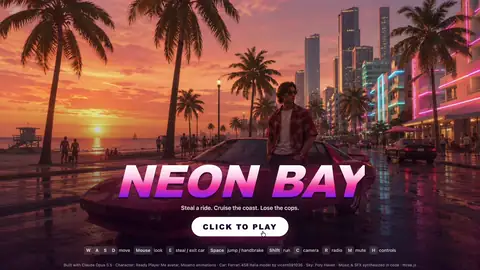
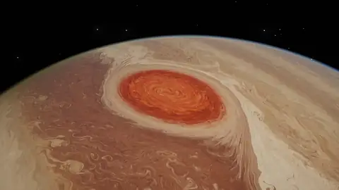
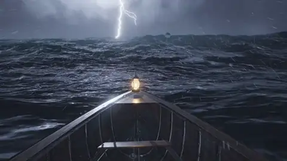
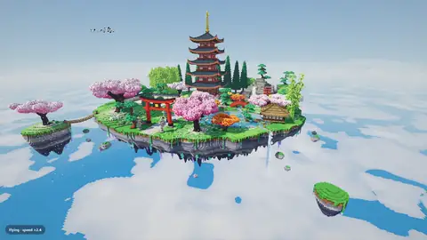
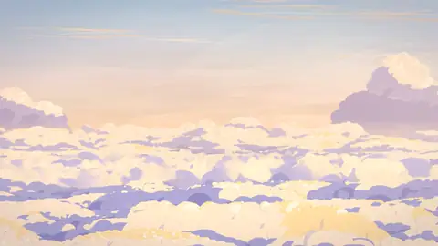
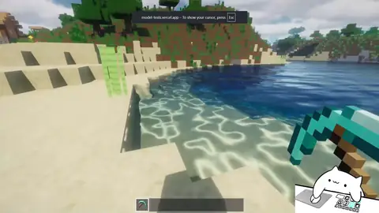

[中文](README.md) | **English**

# Fable 5.5 Testing Series — Claude Fable 5.5 Hands-on Case Index

An index of single-prompt animation, 3D and interactive tests of **Claude Fable 5.5** posted on X (Twitter): links, prompts, build time & cost, and result highlights — all in one place.

> **Note**: As of November 2026, Fable 5.5 has not been officially released by Anthropic. Everything below is early-access / routing reports; please refer to the original posts.
> This repository is an index only. Each preview is a WebP animation of the first 5 seconds of the original video; see the original post for the full piece. All posts and videos belong to their respective authors.

> 💡 **Contribute**: Open an [Issue](../../issues/new?template=submit_case.yml) (the form auto-applies the `submission` label) and paste a tweet link — GitHub Actions will parse, classify and add it to this page and to `data/cases.json` automatically.

## Overview

| Preview | Part | Title | Author | Time | Cost | Length | Date | Post |
| :--- | :--- | :--- | :--- | :--- | :--- | :--- | :--- | :--- |
|  | — | GTA-6 Browser Game in 40 Minutes | @zodchiii | — | — | 50.533s | 2026-11-04 | [Link](https://x.com/zodchiii/status/2117978323343360245) |
|  | — | 83-Second Anime Film in Pure Three.js | @0xMovez | — | — | 83s | 2026-11-04 | [Link](https://x.com/0xMovez/status/2117987052419428576) |
|  | — | One-Prompt 42s Apocalyptic Robot Animation | @ka1manov | — | — | 42s | 2026-11-04 | [Link](https://x.com/ka1manov/status/2118045185972314232) |
|  | — | One-Prompt Jupiter Core Flythrough in One Take | @camperaigg | — | — | 46s | 2026-11-05 | [Link](https://x.com/camperaigg/status/2118246310981910811) |
|  | — | Rowing Into a 31m Wave | @camperaigg | — | — | 35.008s | 2026-11-05 | [Link](https://x.com/camperaigg/status/2118317021935071339) |
|  | — | Best Voxel Pagoda Garden Yet | @legit_api | — | — | 108.083s | 2026-11-04 | [Link](https://x.com/legit_api/status/2117994730336252114) |
|  | — | Animation Video Produced Entirely by Code | @devteamdrew | — | — | 100.083s | 2026-11-04 | [Link](https://x.com/devteamdrew/status/2118008142403649662) |
|  | — | Fable 5.5 One-Shot Minecraft | @notjazii | — | — | 91.8s | 2026-11-01 | [Link](https://x.com/notjazii/status/2116919129974411584) |
|  | — | The Last Page Ghibli-Style Short | @chetaslua | — | — | — | 2026-11-02 | [Link](https://x.com/chetaslua/status/2117224843661980093) |
|  | — | Pure Code Animation | @notjazii | — | — | 262.566s | 2026-11-02 | [Link](https://x.com/notjazii/status/2117221957104239010) |
|  | — | Zero Image Model Animated Short | @chetaslua | — | — | 58.453s | 2026-11-02 | [Link](https://x.com/chetaslua/status/2117224839010459987) |
|  | — | Fable 5.5 Combat Animation | @notjazii | — | — | 30.046s | 2026-11-02 | [Link](https://x.com/notjazii/status/2117261864904351848) |
|  | — | GTA 6 SVG Beach Animation | @imjustnewatai | — | — | 21.385s | 2026-11-03 | [Link](https://x.com/imjustnewatai/status/2117678536794296462) |
|  | — | Life Tree Code Animation | @notjazii | — | — | 30s | 2026-11-04 | [Link](https://x.com/notjazii/status/2117972258090357164) |
|  | — | One-Shot 42s Anime with Fable | @0xMovez | — | — | 42s | 2026-11-03 | [Link](https://x.com/0xmovez/status/2117700681867903169) |
|  | — | Code-Based Video Beats AI Models | @chetaslua | — | — | 80.666s | 2026-11-02 | [Link](https://x.com/chetaslua/status/2117169796290916732) |
|  | Initial | Clockwork Bird | @camperaigg | 1h54m | ~$20 | 60s | 2026-11-03 | [Link](https://x.com/camperaigg/status/2117666378174050352) |
|  | Part 2 | Link's Master Sword | @camperaigg | 32min+ | $11.66 | 34s | 2026-11-03 | [Link](https://x.com/camperaigg/status/2117694354685092255) |
|  | Part 3 | Anime Stickman Sword Fight | @camperaigg | 66min | $15.71 | 46s | 2026-11-03 | [Link](https://x.com/camperaigg/status/2117717189059026969) |
|  | Part 4 | Transformer Truck | @camperaigg | 107min | $9.64 | 12.5s | 2026-11-04 | [Link](https://x.com/camperaigg/status/2117914482752299311) |
|  | Part 5 | Howl's Moving Castle | @camperaigg | 133min | $12.37 | 35s | 2026-11-04 | [Link](https://x.com/camperaigg/status/2117966825048997914) |
|  | Part 6 | Mechanical Heart | @camperaigg | 106min | $12.35 | 30s | 2026-11-04 | [Link](https://x.com/camperaigg/status/2118002649929056373) |
|  | Part 7 | Whale Breach | @camperaigg | 154min | $17.85 | 31s | 2026-11-04 | [Link](https://x.com/camperaigg/status/2118069524306284556) |
## 🎬 Video & Animation

| Preview | Case & Summary | Stack & Status | Prompt / Links |
| :--- | :--- | :--- | :--- |
|  | **83-Second Anime Film in Pure Three.js** One-shot 83-second film in under 3 hours using pure Three.js, 39 shots, 1,992 rendered frames, synthesized audio, single offline HTML file. *By @0xMovez (2026-11-04)* | `Three.js` `HTML5` `Web Audio API` 🏷️ 实测验证 | [🔗 Original post](https://x.com/0xMovez/status/2117987052419428576) 

View Prompt
<pre>未公开</pre>
 |
|  | **One-Prompt 42s Apocalyptic Robot Animation** Fable 5.5 generated a 42-second apocalyptic robot animation from one prompt, reportedly outperforming 90% of video models. *By @ka1manov (2026-11-04)* | `Fable 5.5` 🏷️ 实测验证 | [🔗 Original post](https://x.com/ka1manov/status/2118045185972314232) 

View Prompt
<pre>Make a video animation of apocalyptic worlds with robots</pre>
 |
|  | **One-Prompt Jupiter Core Flythrough in One Take** Single prompt produced a 46-second one-take Jupiter flythrough with custom fluid sim and score. *By @camperaigg (2026-11-05)* | `three.js` `Python` 🏷️ 实测验证 | [🔗 Original post](https://x.com/camperaigg/status/2118246310981910811) 

View Prompt
<pre>Fly a camera straight through Jupiter's core.</pre>
 |
|  | **Rowing Into a 31m Wave** One prompt produced a 35s 1080p60 one-take storm-wave rowing animation with Three.js. *By @camperaigg (2026-11-05)* | `Three.js` `Python` `Claude Code` 🏷️ 实测验证 | [🔗 Original post](https://x.com/camperaigg/status/2118317021935071339) 

View Prompt
<pre>I asked Claude to row me into a 31 m wave in a lightning storm.</pre>
 |
|  | **Animation Video Produced Entirely by Code** Full animation video rendered frame-by-frame with JS and Python by multi-agent teams over 19 hours, no video or image models used. *By @devteamdrew (2026-11-04)* | `JavaScript` `Python` 🏷️ 实测验证 | [🔗 Original post](https://x.com/devteamdrew/status/2118008142403649662) 

View Prompt
<pre>未公开</pre>
 |
| No preview | **The Last Page Ghibli-Style Short** A 60-second hand-drawn 2D anime short about a fox waking a forgotten library, with cinematic Ghibli aesthetics and original score. *By @chetaslua (2026-11-02)* | `HTML5` `Web Audio` 🏷️ 实测验证 | [🔗 Original post](https://x.com/chetaslua/status/2117224843661980093) 

View Prompt
<pre>Create a launch film for Fable 5.5 as a 2D anime short for the web. It must look completely like real Japanese anime, as if it were taken directly from a finished theatrical anime film. This is traditional-looking, hand-drawn 2D anime, not a 3D animation, a moving illustration, a stylized web graphic, or a tech-company product ad.  Deliver the final result as a single, self-contained HTML file with sound. Use any tools, libraries, references, guides, literally anything. Pre-rendering the film and embedding it in the file is allowed. All artwork and audio must be original. The page should be a black, letterboxed cinema frame with one quiet play button (browsers block autoplay with sound) and nothing else on screen.  Use Studio Ghibli films as the art style reference for the design, line work, painted backgrounds, color, and atmosphere, without copying any existing character or shot. No people appear in the film. The main character is an original small red fox, because fables have always been told through animals. Use any tools or techniques you want, including 3D for layout, as long as the final result looks 100% like hand-drawn 2D anime.  THE FILM: "THE LAST PAGE" (about 60 seconds, 24 fps)  The idea: Fable means story. A forgotten library holds every story ever written, and it has been asleep for a very long time. One small fox wakes it up.  Shot 1, Before Dawn (0:00–0:07). Black. The sound of wind comes first. Fade up on a vast blue-violet sea of clouds at the last hour of night. An ancient stone library tower stands on a cliff above the clouds, with a cracked copper dome gone green, wrapped in ivy and old pines. One small warm light moves across a window. Pampas grass sways in the foreground. Almost nothing else moves. Hold.  Shot 2, The Reading Hall (0:07–0:14). Inside, shelves climb into darkness, holding thousands of unique books: leaning, sagging, sun-faded, some with moss growing along the spines. Moonlight falls in one dusty shaft. Tiny against all of this, the fox pads in from the left, carrying a small paper lantern in its mouth. It stops, sets the lantern down, and looks up.  Shot 3, The Fox (0:14–0:18). Close-up. Ears swivel one at a time. It sniffs, then blinks, a real anime blink with a hold on the closed frame. Lantern light shows in its eyes. It is curious and a little afraid, and the audience should fall in love with it here.  Shot 4, The Blank Book (0:18–0:25). An enormous open book rests on a lectern, its pages empty and yellowed. The fox hops up and places one paw on the page. Silence. A single line of ink appears under the paw and begins to draw itself in one confident brushstroke. It becomes a tiny sketched bird. The bird shivers, then peels off the page and flaps into the air, still made of ink and paper.  Shot 5, The Library Stirs (0:25–0:32). A book on a high shelf trembles. Then a whole row. Dust sifts down in thin streams. A deep, low creak travels up through the tower. The lantern flame leans sideways with no wind to move it. The fox flattens its ears. Cut between shelves on hard, held key poses as the tension builds. Hold one beat of total stillness.  Shot 6, The Pages Burst (0:32–0:39). Every book flies open at once. Thousands of pages tear free, folding into paper birds mid-air on sharp drawn frames. Cut to a dramatic low angle looking straight up the circular stairwell as the flock spirals in a huge rising vortex toward the dome. The dome's old copper shutters break open and the first gold light crashes down the shaft.  Shot 7, Sunrise (0:39–0:44). Outside, the sun clears the sea of clouds. The fox has climbed out onto a stone balcony, fur and grass whipping in the wind, tiny against the sky. It looks up with its mouth slightly open. A great ring of wind rolls outward across the clouds.  Shot 8, The Great Bird (0:44–0:52). This is the climax. High in the golden sky, the flock pulls together into one colossal bird made of a hundred thousand pages, with handwriting and old illustrations visible across its wings. It gives one enormous wingbeat with real weight, then tears across the sky in a sweeping arc, leaving a curving trail of light, mist, and loose paper. Make this the widest, most awe-inspiring image in the film.  Shot 9, The Last Page (0:52–1:00). Quiet returns. Pages spiral down through sunbeams onto the balcony. One lands at the fox's paws. It is the only page still blank. The fox looks at it, then at us, and places its paw down. Ink blooms from under the paw and writes, in one hand-brushed stroke:  Fable 5.5  Below it, a small red hanko seal reading 寓話 presses into the paper, followed by one line in smaller brushed lettering: "Every story begins with a blank page."  Hold on the title. The fox's tail flicks once. Fade to paper, then black. Do not add logos, feature lists, benchmarks, or any product claims.  ANIME QUALITY STANDARD Every frame must look as if it was drawn by professional anime animators and painted by master background artists for a finished theatrical film.  Fox: A hand-drawn anime character with a simple, appealing, solid design, cel-colored forms, and clear silhouettes. Keep it on-model from every angle, and let its ears, tail, posture, and eyes express emotion without any words. Paper birds and the great bird: Hand-drawn with real paper character, including creases, curled corners, and faded ink. The great bird must keep a consistent design and feel immense. Line art: Confident, delicate, hand-inked anime line work with subtle variation in thickness and pressure. Coloring: Traditional anime cel coloring with clean color areas, simple hard-edged shadows, and a soft, natural palette. Backgrounds: Richly detailed, hand-painted anime backgrounds in a gouache style, with visible brushwork, natural color variation, layered depth, and individually considered books, stones, foliage, and clouds. Lighting: The film travels from cool moonlit blue and warm lantern amber to overwhelming golden sunrise. Use colorful shadows, glowing mist, drifting dust, and soft atmosphere that unite characters and background. Animation: Authentic hand-drawn anime timing, mostly on twos and threes, with real weight, strong key poses, natural holds, smears on the fastest frames, and overlapping movement in fur, grass, ivy, paper, and dust. The film should build slowly, then release with explosive power. Direction: Cinematic anime shots, beautiful composition, thoughtful staging, and pacing that starts quietly, builds tension, and ends in a soaring climax, followed by one small, tender moment. Text: All text must look brushed in ink on paper and appear only in the final shot, with no web fonts sitting on top of the picture.  SOUND Create an original score and sound design, with no borrowed melodies. Start with wind and near-silence, then add a lone felt piano motif when the fox appears. Bring in low strings and creaking wood during the tremor, then a sudden roar of fluttering paper, and a full orchestral swell at sunrise. At the climax, the piano motif returns at full scale. End with a single soft piano note as the ink touches the final page. Sound effects should include paw steps, lantern flame, ink, dust, page rustle, and the huge wingbeat.  IT MUST NOT LOOK LIKE - 3D: No plastic materials, CGI shading, visible polygons, game-engine lighting, or computer-perfect perspective. - SVG or vector art: No simple geometric shapes, perfect curves, uniform outlines, flat corporate illustration, or basic gradients. - Web animation: No sliding layers, constant bobbing, floating parts, smooth software easing, or puppet-like joint rotation. - AI art: No warped shapes, melted details, flickering, garbled text, or changing character designs. - Non-anime art: No Western cartoon designs, realistic rendering, soft painterly shading on the characters, or generic digital illustration. - Tech advertising: No glowing neural networks, circuit patterns, chat bubbles, UI mockups, futuristic HUDs, particle-logo reveals, or typed-out text effects. - Amateur work: No stiff poses, empty backgrounds, repeated books or trees, identical paper birds, muddy colors, clip art, placeholders, or unfinished details.  You are free to change any part of this prompt if it would produce a better result.  The result should feel awe-inspiring, nostalgic, and full of wonder, like the moment a story you loved as a child comes back to you. Before finishing, inspect random frames as still images from every shot. If any frame does not look completely like real 2D anime, keep improving it. Do not stop until every frame could pass as a still from a theatrical anime film.</pre>
 |
|  | **Pure Code Animation** Generated a stunning animation in pure code without external assets within an hour. *By @notjazii (2026-11-02)* | 🏷️ 灰度路由/传闻 | [🔗 Original post](https://x.com/notjazii/status/2117221957104239010) 

View Prompt
<pre>make an animation that makes me feel like it’s agi</pre>
 |
|  | **Zero Image Model Animated Short** Generated a 66-second animated short using self-written Python code without image models. *By @chetaslua (2026-11-02)* | `Python` `HTML5` 🏷️ 实测验证 | [🔗 Original post](https://x.com/chetaslua/status/2117224839010459987) 

View Prompt
<pre>未公开</pre>
 |
|  | **Fable 5.5 Combat Animation** Highlights Claude Fable 5.5’s flexible ability to generate combat animations and its broad potential. *By @notjazii (2026-11-02)* | 🏷️ 灰度路由/传闻 | [🔗 Original post](https://x.com/notjazii/status/2117261864904351848) 

View Prompt
<pre>未公开</pre>
 |
|  | **GTA 6 SVG Beach Animation** Fable 5.5 generated a self-contained SVG animation of GTA 6 beach scenes with physics. *By @imjustnewatai (2026-11-03)* | `SVG` `HTML5` 🏷️ 实测验证 | [🔗 Original post](https://x.com/imjustnewatai/status/2117678536794296462) 

View Prompt
<pre>I asked Fable 5.5, to create an SVG animation of GTA 6 on a crowded, sunny beach. A German shepherd takes a shit in the sand, then the player gets into a fistfight with a nearby NPC. Include photorealistic graphics, realistic physics, ocean waves, animated beachgoers, a third-person camera, and a GTA-style minimap. Render everything in one self-contained SVG file.</pre>
 |
|  | **Life Tree Code Animation** Fable 5.5 generated a complex life tree animation with pure code in one shot. *By @notjazii (2026-11-04)* | 🏷️ 灰度路由/传闻 | [🔗 Original post](https://x.com/notjazii/status/2117972258090357164) 

View Prompt
<pre>未公开</pre>
 |
|  | **One-Shot 42s Anime with Fable** One-shot 42-second Three.js animation without video models, fully offline. *By @0xMovez (2026-11-03)* | `Three.js` `HTML5` 🏷️ 实测验证 | [🔗 Original post](https://x.com/0xmovez/status/2117700681867903169) 

View Prompt
<pre>未公开</pre>
 |
|  | **Code-Based Video Beats AI Models** A single prompt generates high-quality video, outperforming AI video models. *By @chetaslua (2026-11-02)* | 🏷️ 灰度路由/传闻 | [🔗 Original post](https://x.com/chetaslua/status/2117169796290916732) 

View Prompt
<pre>未公开</pre>
 |
|  | **Clockwork Bird** A fully vector clockwork bird assembles itself on camera, with an original waltz and purely math-synthesized sound effects throughout. *By @camperaigg (2026-11-03)* | `Claude Code` `HyperFrames` 🏷️ 实测验证 | [🔗 Original post](https://x.com/camperaigg/status/2117666378174050352) 

View Prompt
<pre>一句提示词（未公开完整原文）</pre>
 |
|  | **Link's Master Sword** Link's Master Sword modeled and filmed by a single Blender script, with an original orchestral score. *By @camperaigg (2026-11-03)* | `Claude Code` `Blender` 🏷️ 实测验证 | [🔗 Original post](https://x.com/camperaigg/status/2117694354685092255) 

View Prompt
<pre>Build Link's Master Sword in Blender（后续追加“make a video of it”）</pre>
 |
|  | **Anime Stickman Sword Fight** Anime-style stickman sword fight: cloth simulation, impact flashes and 228 physics-synced sound effects. *By @camperaigg (2026-11-03)* | `Claude Code` 🏷️ 实测验证 | [🔗 Original post](https://x.com/camperaigg/status/2117717189059026969) 

View Prompt
<pre>Make me a video of 2 stickman fighting, anime style.</pre>
 |
|  | **Transformer Truck** A fully rigged transforming truck with Geometry Nodes rain, ripples and fully synthesized mechanical sounds. *By @camperaigg (2026-11-04)* | `Claude Code` `Blender` 🏷️ 实测验证 | [🔗 Original post](https://x.com/camperaigg/status/2117914482752299311) 

View Prompt
<pre>Make me a transformer truck with animations of its transforming.</pre>
 |
|  | **Howl's Moving Castle** A walking castle: full steam-engine-to-gait modeling with a mid-video shell cutaway. *By @camperaigg (2026-11-04)* | `Claude Code` `Blender` 🏷️ 实测验证 | [🔗 Original post](https://x.com/camperaigg/status/2117966825048997914) 

View Prompt
<pre>Make me Howl's moving castle and also show its internal machinery.</pre>
 |
|  | **Mechanical Heart** A mechanical heart with a cutaway animation: twin-piston crankshaft and a heartbeat-synced score. *By @camperaigg (2026-11-04)* | `Claude Code` `Blender` 🏷️ 实测验证 | [🔗 Original post](https://x.com/camperaigg/status/2118002649929056373) 

View Prompt
<pre>Make a mechanical heart and show its insides, use blender.</pre>
 |
|  | **Whale Breach** A whale breaches a cel-shaded ocean: 16.9M-particle fluid and a 1.09M-triangle whale built purely in code. *By @camperaigg (2026-11-04)* | `Claude Code` 🏷️ 实测验证 | [🔗 Original post](https://x.com/camperaigg/status/2118069524306284556) 

View Prompt
<pre>Make a whale breach a cel-shaded ocean.</pre>
 |
## 📱 Interactive H5 & Apps

| Preview | Case & Summary | Stack & Status | Prompt / Links |
| :--- | :--- | :--- | :--- |
|  | **Best Voxel Pagoda Garden Yet** An older Fable 5.5 checkpoint produced the best voxel pagoda garden attempt so far. *By @legit_api (2026-11-04)* | 🏷️ 实测验证 | [🔗 Original post](https://x.com/legit_api/status/2117994730336252114) 

View Prompt
<pre>standard voxel pagoda garden prompt</pre>
 |
## 🎮 Games & Physics

| Preview | Case & Summary | Stack & Status | Prompt / Links |
| :--- | :--- | :--- | :--- |
|  | **GTA-6 Browser Game in 40 Minutes** Built with Fable 5.5 and Three.js, this free browser GTA-style game lets you steal cars, drift, and outrun cops. *By @zodchiii (2026-11-04)* | `Fable 5.5` `GPT Image` `Three.js` `Mixamo` `Vercel` 🏷️ 实测验证 | [🔗 Original post](https://x.com/zodchiii/status/2117978323343360245) / [🕹️ Live demo](https://playneonbay.vercel.app) 

View Prompt
<pre>未公开</pre>
 |
|  | **Fable 5.5 One-Shot Minecraft** Fable 5.5 generates a highly detailed Minecraft-style web scene in one shot. *By @notjazii (2026-11-01)* | `HTML5` 🏷️ 实测验证 | [🔗 Original post](https://x.com/notjazii/status/2116919129974411584) / [🕹️ Live demo](https://model-tests.vercel.app/) 

View Prompt
<pre>detailed minecraft one-shot</pre>
 |
## Detailed Notes
### Initial: Clockwork Bird
- **Post**: [https://x.com/camperaigg/status/2117666378174050352](https://x.com/camperaigg/status/2117666378174050352) · **Time**: 1h54m · **Cost**: ~$20 · **Length**: 60s- **Prompt**: 一句提示词（未公开完整原文）
- **Highlights**: Vector clockwork-bird parts fly in and assemble; one continuous shot; Original waltz score throughout; Purely math-synthesized SFX, frame-accurate to ±5ms
### Part 2: Link's Master Sword
- **Post**: [https://x.com/camperaigg/status/2117694354685092255](https://x.com/camperaigg/status/2117694354685092255) · **Time**: 32min+ · **Cost**: $11.66 · **Length**: 34s- **Prompt**: Build Link's Master Sword in Blender（后续追加“make a video of it”）
- **Highlights**: Complete single-script modeling (Triforce relief, braided grip, layered feather guard); Automatic z-fighting fixes; Continuous camera move, forest lighting, original orchestral score
### Part 3: Anime Stickman Sword Fight
- **Post**: [https://x.com/camperaigg/status/2117717189059026969](https://x.com/camperaigg/status/2117717189059026969) · **Time**: 66min · **Cost**: $15.71 · **Length**: 46s- **Prompt**: Make me a video of 2 stickman fighting, anime style.
- **Highlights**: Rigged bones + 120Hz cloth; lightning katana vs flame greatsword; One-frame impact flashes (mono/inverted/duotone); Original 120BPM score with 16 instruments; 228 physics-synced SFX (79 auto-detected from sword-tip velocity); Full silence right before the climax
### Part 4: Transformer Truck
- **Post**: [https://x.com/camperaigg/status/2117914482752299311](https://x.com/camperaigg/status/2117914482752299311) · **Time**: 107min · **Cost**: $9.64 · **Length**: 12.5s- **Prompt**: Make me a transformer truck with animations of its transforming.
- **Highlights**: 51-joint rig with ground solving; Geometry Nodes rain and ripples; 64 fully synthesized SFX (diesel, air brakes, servos)
### Part 5: Howl's Moving Castle
- **Post**: [https://x.com/camperaigg/status/2117966825048997914](https://x.com/camperaigg/status/2117966825048997914) · **Time**: 133min · **Cost**: $12.37 · **Length**: 35s- **Prompt**: Make me Howl's moving castle and also show its internal machinery.
- **Highlights**: Complete steam engine → gear train → four-legged gait (solved from the planted foot); Mid-video shell cutaway; Waltz-exact stepping (1.4s/beat); Self-detected and optimized grass rendering (9.3s → 4.2s/frame)
### Part 6: Mechanical Heart
- **Post**: [https://x.com/camperaigg/status/2118002649929056373](https://x.com/camperaigg/status/2118002649929056373) · **Time**: 106min · **Cost**: $12.35 · **Length**: 30s- **Prompt**: Make a mechanical heart and show its insides, use blender.
- **Highlights**: Twin-piston crankshaft, shell-opening animation; Golden oil bubbles and drips; Heartbeat-synced score; Self-diagnosed hidden lighting issue
### Part 7: Whale Breach
- **Post**: [https://x.com/camperaigg/status/2118069524306284556](https://x.com/camperaigg/status/2118069524306284556) · **Time**: 154min · **Cost**: $17.85 · **Length**: 31s- **Prompt**: Make a whale breach a cel-shaded ocean.
- **Highlights**: 16.9M-particle fluid (1200 steps/s); Three-layer FFT waves + cel shading; 1.09M-triangle whale built purely in code; Underwater optics (Snell's window); Self-detected and re-rendered intersection artifacts
## Related Resources
- Other Fable 5.5 community collections: [awesome-fable5-5-videos](https://github.com/billyhetech/awesome-fable5-5-videos), [awesome-fable-5.5-usecase](https://github.com/coolbat/awesome-fable-5.5-usecase)

## Notes & Copyright
- All videos and descriptions come from the authors' public posts; please refer to the originals.
- The index itself is released under the [MIT License](LICENSE); the linked posts and videos belong to their original authors.
- Seed cases are @camperaigg's Fable 5.5 Testing Series (Parts 1–7).
